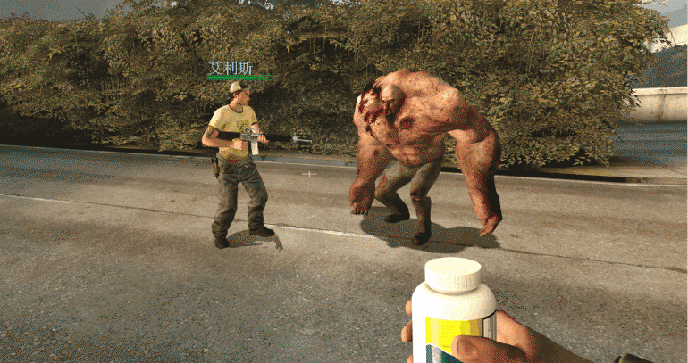
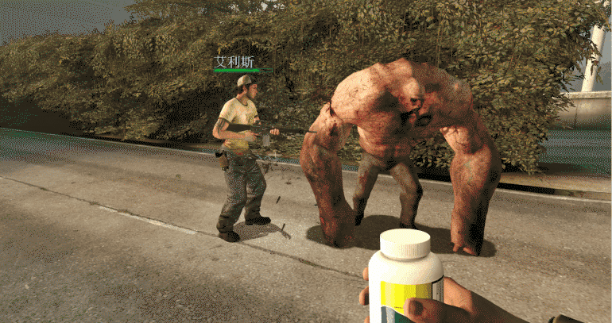

# Description | 內容
Improves survivor bot AI to prevent them from blindly or unnecessarily using pills, adrenaline shots and first aid kits.

> __Note__ <br/>
This plugin is private, Please contact [me](/#私人插件列表-private-plugins-list)<br/>
此為私人插件, 請聯繫[本人](/#私人插件列表-private-plugins-list)

* Apply to | 適用於
	```
	L4D1
	L4D2
	```

* Image | 圖示
	| Before (裝此插件之前)  			| After (裝此插件之後) |
	| -------------|:-----------------:|
	| ||

* <details><summary>How does it work?</summary>

	* Set the health value and incap counts required before bot using any medical items
	* Survivor bots will not heal or take pills/adrenaline shots if their health is still fine.
	* Survivor bots will not try to heal others or give pills/adrenaline shots if target's health is still fine.
	* Block bots from immediately takeing pills/adrenaline passed by teammates if health is fine, switch to main weapons.
</details>

* Require | 必要安裝
	1. [Actions](https://forums.alliedmods.net/showthread.php?t=336374)
	2. [l4d_heartbeat](https://github.com/fbef0102/L4D1_2-Plugins/tree/master/l4d_heartbeat)
	3. [left4dhooks](https://forums.alliedmods.net/showthread.php?t=321696)
	4. [sourcescramble](https://github.com/nosoop/SMExt-SourceScramble/releases)

* Directory Structure | 檔案結構
	```php
    /
    ├── gamedata/
    │   └── l4d_bot_block_heal.txt            # GameData | 遊戲數據
    ├── plugins/
    │   └── l4d_bot_block_heal.smx            # Compiled plugin | 已編譯的插件
    ├── scripting/
    │   └── l4d_bot_block_heal.sp             # Source code | 源碼
    ```

* <details><summary>ConVar | 指令</summary>

	* cfg/sourcemod/l4d_bot_block_heal.cfg
		```php
		// If 1, Block bots from immediately takeing pills/adrenaline passed by teammates if health is fine, switch to main weapons.
		l4d_bot_block_heal_given_stop_use "1"

		// If 1, bots will ignore incap count limit set by this plugin once final starts
		l4d_bot_block_heal_final_ignore_incaps "1"

		// If 1, bots will ignore health threshold set by this plugin once final starts
		l4d_bot_block_heal_final_ignore_threshold "0"

		// Allow bots to use First Aid Kits when the bot itself health is less than or equal to this value. (0=Prohibited)
		l4d_bot_block_heal_kit_self_threshold "40"

		// Allow bots to use First Aid Kits when the target is a bot and its health is less than or equal to this value. (0=Prohibited)
		l4d_bot_block_heal_kit_bot_threshold "40"

		// Allow bots to use First Aid Kits when the target is a real player and its health is less than or equal to this value. (0=Prohibited)
		l4d_bot_block_heal_kit_player_threshold "40"

		// Only allow healing when the bot itself incap count is greater than or equal to this value. (0=Before incap)
		l4d_bot_block_heal_kit_self_incaps "1"

		// Only allow healing when the target is a bot and incap count is greater than or equal to this value. (0=Before incap)
		l4d_bot_block_heal_kit_bot_incaps "1"

		// Only allow healing when the target is a real player and incap count is greater than or equal to this value. (0=Before incap)
		l4d_bot_block_heal_kit_player_incaps "0"

		// Allow bots to pop pills when the bot itself health is less than or equal to this value. (0=Prohibited)
		l4d_bot_block_heal_pill_self_threshold "40"

		// Allow bots to give pills when the target is a bot and its health is less than or equal to this value. (0=Prohibited)
		l4d_bot_block_heal_pill_bot_threshold "40"

		// Allow bots to give pills when the target is a real player and its health is less than or equal to this value. (0=Prohibited)
		l4d_bot_block_heal_pill_player_threshold "50"

		// Only allow popping pills when the bot itself incap count is greater than or equal to this value. (0=Before incap)
		l4d_bot_block_heal_pill_self_incaps "1"

		// Only allow giving pills when the target is a bot and incap count is greater than or equal to this value. (0=Before incap)
		l4d_bot_block_heal_pill_bot_incaps "1"

		// Only allow giving pills when the target is a real player and incap count is greater than or equal to this value. (0=Before incap)
		l4d_bot_block_heal_pill_player_incaps "0"

		// (L4D2) Allow bots to pop adrenaline shots when the bot itself health is less than or equal to this value. (0=Prohibited)
		l4d_bot_block_heal_adrenaline_self_threshold "30"

		// (L4D2) Allow bots to give adrenaline shots when the target is a bot and its health is less than or equal to this value. (0=Prohibited)
		l4d_bot_block_heal_adrenaline_bot_threshold "30"

		// (L4D2) Allow bots to give adrenaline shots when the target is a real player and its health is less than or equal to this value. (0=Prohibited)
		l4d_bot_block_heal_adrenaline_player_threshold "50"

		// (L4D2) Only allow popping adrenaline shots when the bot itself incap count is greater than or equal to this value. (0=Before incap)
		l4d_bot_block_heal_adrenaline_self_incaps "1"

		// (L4D2) Only allow giving adrenaline shots when the target is a bot and incap count is greater than or equal to this value. (0=Before incap)
		l4d_bot_block_heal_adrenaline_bot_incaps "1"

		// (L4D2) Only allow giving adrenalines shots when the target is a real player and incap count is greater than or equal to this value. (0=Before incap)
		l4d_bot_block_heal_adrenaline_player_incaps "0"
		```
</details>

* <details><summary>Changelog | 版本日誌</summary>

	* v1.3h (2026-10-13)
		* Bots will ignore incap count limit set by this plugin once final starts
		* Bots will ignore health threshold set by this plugin once final starts
		* Update cvars

	* v1.2h (2026-10-12)
		* Add adrenaline shots
		* Block bots from immediately takeing pills/adrenaline passed by teammates if health is fine.
		* Require left4dhooks, sourcescramble
		* Add gamedata
		* Update cvars

	* v1.1h (2024-10-3)
		* Require l4d_heartbeat
		* Upate cvars

	* v1.0h (2023-6-19)
		* Add Cvars to tell if Target is self or teammate bot or teammate real player

	* Credits
		* Original: [By SilverShot](https://forums.alliedmods.net/showthread.php?t=338889)
</details>

- - - -
# 中文說明
解決倖存者Bot經常亂打包與亂吃藥丸的智商

* 原理
	* 當Bot想要使用治療包或者吃藥丸/打針之前，先判定自身血量，如果條件不足則不會亂使用
	* 當Bot想要治療隊友或者給其他人藥丸/打針之前，先判定對方血量，如果條件不足則不會亂打包或是亂給
	* 血量高於指令設定的值，Bot不會有任何動作
	* 遞給Bot藥丸與針的時候，Bot如果血量健康不會馬上吃下去，切回主武器

* <details><summary>指令中文介紹 (點我展開)</summary>

	* cfg/sourcemod/l4d_bot_block_heal.cfg
		```php
		// 為1時，遞給Bot藥丸與針的時候，Bot如果血量健康不會馬上吃下去，切回主武器
		l4d_bot_block_heal_given_stop_use "1"

		// 為1時，當救援開始後，Bot思考醫療物品時忽略此插件設置的倒地次數限制
		l4d_bot_block_heal_final_ignore_incaps "1"

		// 為1時，當救援開始後，Bot思考醫療物品時忽略此插件設置的血量限制
		l4d_bot_block_heal_final_ignore_threshold "0"

		// Bot何時能才會對自己使用治療包
		// 自身的血量小於等於此數值 (0=永遠禁止治療)
		l4d_bot_block_heal_kit_self_threshold "40"

		// Bot何時能才會對其他Bot使用治療包
		// 其他Bot的血量小於等於此數值 (0=永遠不會治療其他Bot)
		l4d_bot_block_heal_kit_bot_threshold "40"

		// Bot何時能才會對真人玩家使用治療包
		// 真人玩家的血量小於等於此數值 (0=永遠不會治療真人玩家)
		l4d_bot_block_heal_kit_player_threshold "40"

		// Bot何時能才會對自己使用治療包
		// 自身的倒地次數大於等於此數值 (0=倒地之前可以治療)
		l4d_bot_block_heal_kit_self_incaps "1"

		// Bot何時能才會對其他Bot使用治療包
		// 其他Bot的倒地次數大於等於此數值 (0=可以治療倒地之前的其他Bot)
		l4d_bot_block_heal_kit_bot_incaps "1"

		// Bot何時能才會對真人玩家使用治療包
		// 真人玩家的倒地次數大於等於此數值 (0=可以治療倒地之前的真人玩家)
		l4d_bot_block_heal_kit_player_incaps "0"

		// Bot何時能才會對自己使用藥丸
		// 自身的血量小於等於此數值 (0=永遠禁止吃藥)
		l4d_bot_block_heal_pill_self_threshold "40"

		// Bot何時能才會遞給其他Bot藥丸
		// 其他Bot的血量小於等於此數值 (0=永遠不會給其他Bot藥丸)
		l4d_bot_block_heal_pill_bot_threshold "40"

		// Bot何時能才會遞給真人玩家藥丸
		// 真人玩家的血量小於等於此數值 (0=永遠禁止給真人玩家)
		l4d_bot_block_heal_pill_player_threshold "50"

		// Bot何時能才會對自己使用藥丸
		// 自身的倒地次數大於等於此數值 (0=倒地之前可以吃藥)
		l4d_bot_block_heal_pill_self_incaps "1"

		// Bot何時能才會遞給其他Bot藥丸
		// 其他Bot的倒地次數大於等於此數值 (0=可以遞給倒地之前的其他Bot)
		l4d_bot_block_heal_pill_bot_incaps "1"

		// Bot何時能才會遞給真人玩家藥丸
		// 真人玩家的倒地次數大於等於此數值 (0=可以遞給倒地之前的真人玩家)
		l4d_bot_block_heal_pill_player_incaps "0"

		// (L4D2) Bot何時能才會對自己使用腎上腺素
		// 自身的血量小於等於此數值 (0=永遠禁止打針)
		l4d_bot_block_heal_adrenaline_self_threshold "30"

		// (L4D2) Bot何時能才會遞給其他Bot腎上腺素
		// 其他Bot的血量小於等於此數值 (0=永遠不會給其他Bot)
		l4d_bot_block_heal_adrenaline_bot_threshold "30"

		// (L4D2) Bot何時能才會對真人玩家腎上腺素
		// 真人玩家的血量小於等於此數值 (0=永遠不會給真人玩家)
		l4d_bot_block_heal_adrenaline_player_threshold "50"

		// (L4D2) Bot何時能才會對自己使用腎上腺素
		// 自身的倒地次數大於等於此數值 (0=倒地之前可以打針)
		l4d_bot_block_heal_adrenaline_self_incaps "1"

		// (L4D2) Bot何時能才會遞給其他Bot腎上腺素
		// 其他Bot的倒地次數大於等於此數值 (0=可以遞給倒地之前的其他Bot)
		l4d_bot_block_heal_adrenaline_bot_incaps "1"

		// (L4D2) Bot何時能才會遞給真人玩家腎上腺素
		// 真人玩家的倒地次數大於等於此數值 (0=可以遞給倒地之前的真人玩家)
		l4d_bot_block_heal_adrenaline_player_incaps "0"
		```
</details>