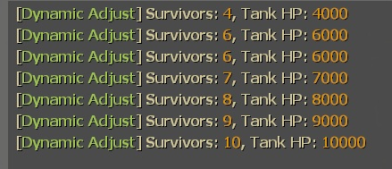

# Description | 內容
Dynamic Adjust Tank/S.I. HP depends on 5+ survivors in server

> __Note__ <br/>
This plugin is private, Please contact [me](/#私人插件列表-private-plugins-list)<br/>
此為私人插件, 請聯繫[本人](/#私人插件列表-private-plugins-list)

* Apply to | 適用於
	```
	L4D1
	L4D2
	```

* Image | 圖示
	<br/>

* <details><summary>How does it work?</summary>

	* Modify data file: [data/l4d_si_hp_dynamic_adjust.cfg](data/l4d_si_hp_dynamic_adjust.cfg)
		* Manual in this file, click for more details...
	* Adjust Tank HP and S.I. health depends on 5+ survivors in server 
</details>

* Require | 必要安裝
	1. [left4dhooks](https://forums.alliedmods.net/showthread.php?t=321696)
	2. [[INC] Multi Colors](https://github.com/fbef0102/L4D1_2-Plugins/releases/tag/Multi-Colors)
	3. [l4d_pz_health_forward](https://github.com/Target5150/MoYu_Server_Stupid_Plugins/tree/master/The%20Last%20Stand/l4d_pz_health_forward)

* Directory Structure | 檔案結構
	```php
    /
    ├── data/
    │   └── l4d_si_hp_dynamic_adjust.cfg            # Set Tank HP | 設置Tank血量
    ├── plugins/
    │   └── l4d_si_hp_dynamic_adjust.smx            # Compiled plugin | 已編譯的插件
    └── scripting/
        └── l4d_si_hp_dynamic_adjust.sp             # Source code | 源碼
    ```

* <details><summary>ConVar | 指令</summary>

	* cfg/sourcemod/l4d_si_hp_dynamic_adjust.cfg
		```php
		// 0=Plugin off, 1=Plugin on.
		l4d_si_hp_dynamic_adjust_enable "1"

		// 1=Enable notify, 0=Disable notify
		l4d_si_hp_dynamic_adjust_hint "1"

		// Dynamic Adjust Tank Hp depends on, 0=the number of alive survivors, 1=the number of alive + dead survivors.
		l4d_si_hp_dynamic_adjust_including_dead "0"
		```
</details>

* <details><summary>Changelog | 版本日誌</summary>

	* v1.3 (2026-11-7)
		* Change plugin name
		* Modify Smoker, Boomer, Hunter, Spitter, Jockey, Charger health
		* Require l4d_pz_health_forward to set tank health

	* v1.2 (2026-11-6)
		* Rewrite code and data

	* v1.1 (2024-8-23)
		* Add hp hinet when tank spawned

	* v1.0 (2024-7-15)
		* Initial Release
</details>

- - - -
# 中文說明
隨著玩家人數越多，Tank與特感的血量越厚

* 原理
	* 修改文件: [data/l4d_si_hp_dynamic_adjust.cfg](data/l4d_si_hp_dynamic_adjust.cfg)
		* 內有中文說明書
	* 根據玩家人數設置Tank與特感的血量

* <details><summary>指令中文介紹 (點我展開)</summary>

	* cfg/sourcemod/l4d_si_hp_dynamic_adjust.cfg
		```php
		// 0=關閉插件, 1=啟動插件
		l4d_si_hp_dynamic_adjust_enable "1"

		// 1=啟用提示, 0=關閉提示
		l4d_si_hp_dynamic_adjust_hint "1"

		// 根據何種方式計算倖存者人數, 0=活著的倖存者人數, 1=活著+死亡的倖存者人數
		l4d_si_hp_dynamic_adjust_including_dead "0"
		```
</details>