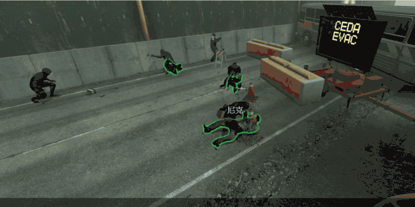
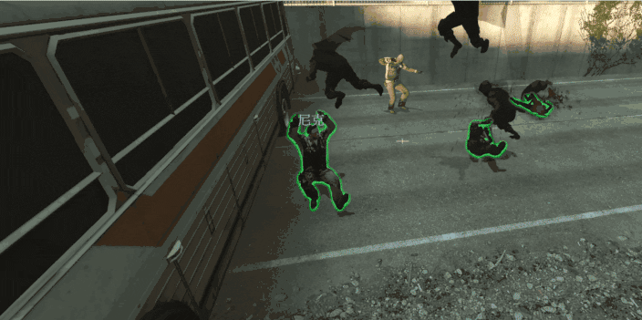

# Description | 內容
Slays all survivors or special infected if survivors are simultaneously incapped/pinned

> __Note__ <br/>
This plugin is private, Please contact [me](/#私人插件列表-private-plugins-list)<br/>
此為私人插件, 請聯繫[本人](/#私人插件列表-private-plugins-list)

* Apply to | 適用於
	```
	L4D1
	L4D2
	```

* Image | 圖示
	* Auto wipe all survivors (處死倖存者)
	<br/>
	* Auti clear all special infected (處死特感)
	<br/>

* <details><summary>How does it work?</summary>

	* When survivors are simultaneously incapped/pinned, active autowipe mode (depends on cvar you set)
		* Slay Survivors: slay all survivors in 3 seconds
		* Slay Infected: slay all special infected in 3 seconds
	* If a player is not incapped or not pinned by Special Infected, no players will be slain.
</Chargedetails>

* Require | 必要安裝
	1. [left4dhooks](https://forums.alliedmods.net/showthread.php?t=321696)
	2. [[INC] Multi Colors](https://github.com/fbef0102/L4D1_2-Plugins/releases/tag/Multi-Colors)

* Directory Structure | 檔案結構
	```php
    /
    ├── plugins/
    │   └── l4d_autowipe.smx            # Compiled plugin | 已編譯的插件
    ├── scripting/
    │   └── l4d_autowipe.sp             # Source code | 源碼
    └── translations/
        └── l4d_autowipe.phrases.txt    # Multi-language translation | 翻譯多國語言
    ```

* <details><summary>ConVar | 指令</summary>

	* cfg/sourcemod/l4d_autowipe.cfg
		```php
		// 0=Plugin off, 1=Plugin on.
		l4d_autowipe_enable "1"

		// How message displays. (0: Disable, 1:In chat, 2: In Hint Box, 3: In center text)
		l4d_autowipe_announce_type "1"

		// AutoWipe mode, on all survivors incapacitated/pinned: 0 = Slay Survivors, 1 = Slay Infected
		l4d_autowipe_mode "0"

		// Time(sec) before pinned/incapacitated survivor team is slayed by 'Slay Survivors' AutoWipe mode
		l4d_autowipe_grace_period "3.0"

		// Time(sec) before survivor team is cleared by 'Slay Infected' AutoWipe mode
		l4d_autowipe_clear_delay "3.0"

		// 0 = Only infected pinning survivors are slayed, 1 = All infected are slayed
		l4d_autowipe_slay_all_infected "1"
		```
</details>

* <details><summary>Changelog | 版本日誌</summary>

	* v1.0 (2026-10-24)
		* Remake, clean up and organize code
		* Remove left4downtown, require left4dhooks

	* Credits
		* [Original Plugin by Breezy](https://github.com/DomRR/hardcoop/blob/master/addons/sourcemod/scripting/autoslayer.sp)
</details>

- - - -
# 中文說明
當所有倖存者同時倒地與被特感抓時，自動滅團所有倖存者或是處死所有特感

* 原理
	* 當所有同時倒地與被特感抓時，啟動自動處死模式 (依據你設置的指令)
		* 第一種: 3秒後處死所有倖存者
		* 第二種: 3秒後處死所有特感
	* 當沒有人倒地或是被特幹抓時，時間到之後不會處死任何玩家

* <details><summary>指令中文介紹(點我展開)</summary>

	* cfg/sourcemod/l4d_autowipe.cfg
		```php
		//  0=關閉插件, 1=啟動插件.
		l4d_autowipe_enable "1"

		// 提示該如何顯示. (0: 不提示, 1: 聊天框, 2: 黑底白字框, 3: 螢幕正中間)
		l4d_autowipe_announce_type "1"

		// 自動處死模式, 當所有倖存者同時倒地與被特感抓時: 0 = 處死所有倖存者, 1 = 處死所有特感
		l4d_autowipe_mode "0"

		// (如果模式為處死所有倖存者) 幾秒後處死
		l4d_autowipe_grace_period "3.0"

		// (如果模式為處死所有特感) 幾秒後處死
		l4d_autowipe_clear_delay "3.0"

		// (如果模式為處死所有特感) 0 = 只處死有抓到人類的特感, 1 = 處死所有特感
		l4d_autowipe_slay_all_infected "1"
		```
</details>