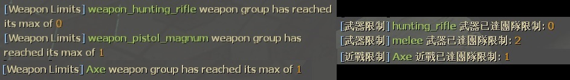

# Description | 內容
Restrict weapons and melee weapons individually, or by weapon group.

> __Note__ <br/>
This plugin is private, Please contact [me](/#私人插件列表-private-plugins-list)<br/>
此為私人插件, 請聯繫[本人](/#私人插件列表-private-plugins-list)

* Apply to | 適用於
    ```
    L4D2
    ```

* Image | 圖示
    <br/>

* <details><summary>How does it work?</summary>

    * Open [data/l4d_weapon_limits_remake.cfg](data/l4d_weapon_limits_remake.cfg) and set weapon/melee limit
    * When limit reached, any of players can't pick up specific weapons or melees
    * Or set limit by weapon group, for example: melees, snipers
    * Apply to bots and real players
</details>

* Require | 必要安裝
    1. [left4dhooks](https://forums.alliedmods.net/showthread.php?t=321696)
    2. [[INC] Multi Colors](https://github.com/fbef0102/L4D1_2-Plugins/releases/tag/Multi-Colors)
    3. [[INC] l4d2_weapons](/L4D_插件/Require_檔案/scripting/include/l4d2_weapons.inc)

* Directory Structure | 檔案結構
	```php
    /
    ├── data/
    │   └── l4d_weapon_limits_remake.txt            # Set gun/melee weapon limit | 設置武器或近戰數量限制
    ├── gamedata/
    │   └── l4d_weapon_limits_remake.txt            # GameData | 遊戲數據
    ├── plugins/
    │   └── l4d_weapon_limits_remake.smx            # Compiled plugin | 已編譯的插件
    ├── scripting/
    │   └── l4d_weapon_limits_remake.sp             # Source code | 源碼
    └── translations/
        └── l4d_weapon_limits_remake.phrases.txt    # Multi-language translation | 翻譯多國語言
    ```

* <details><summary>Support | 支援插件</summary>

    1. [l4d_multiple_equipment_remake](/L4D_插件/Nothing_Impossible_無理改造版/l4d_multiple_equipment_remake): Restrict weapons and melees when carry second equipment (No conflict)
        * 每個人攜帶的第二把武器或物品也會被限制 (與此插件不衝突)
</details>

* <details><summary>Other Version | 其他版本</summary>

    1. [l4d_limitweapon](https://github.com/fbef0102/L4D1_2-Plugins/tree/master/l4d_limitweapon): (L4D1) Restrict each weapon individually or together
        > (L4D1) 限制每個武器可以拿取的數量，超過就不能拿取
</details>

* <details><summary>ConVar | 指令</summary>

    * cfg/sourcemod/l4d_weapon_limits_remake.cfg
        ```php
        // Time interval bewteen weapon limit notify. (0=off)
        l4d_weapon_limits_remake_cooltime_block "3.0"
        ```
</details>

* <details><summary>Changelog | 版本日誌</summary>

    * v2.6 (2026-10-20)
        * Clean up and organize code (Remake)
        * Add data file
        * Delete cmd
        * Change name 

    * v2.5 (2025-1-15)
        * Fixed m60 or grenade launcher disappear

    * v2.4 (2024-5-11)
        * Support Custom Melee
        * Fixed melee error

    * v2.2 (2023-12-13)
        * Compatible with l4d_multiple_equipment_remake v1.2h or above by harry
        * Support each melee class limit
        * Translation Support
        * Fixed player can not pick up the same weapon
        * Fixed player can still break the limit can pick up weapon

    * v2.1
        * Remove some cmds

    * v2.0
        * [By CanadaRox, Stabby, Forgetest, A1m`, robex](https://github.com/SirPlease/L4D2-Competitive-Rework/blob/master/addons/sourcemod/scripting/l4d_weapon_limits.sp)
</details>

- - - -
# 中文說明
限制倖存者隊伍的武器與近戰的數量，或按武器類別進行限制，超過數量就不能拿取

* 原理
    * 打開文件 [data/l4d_weapon_limits_remake.cfg](data/l4d_weapon_limits_remake.cfg)，修改武器數量限制
    * 當玩家要撿起武器時，計算隊友已經攜帶的數量，超過限制便不能撿起武器
    * 可以進一步限制每種近戰種類或武器種類，舉例: 近戰武器、狙擊槍
    * 適用真人玩家與Bot

* <details><summary>指令中文介紹 (點我展開)</summary>

    * cfg/sourcemod/l4d_weapon_limits_remake.cfg
        ```php
        // 訊息提示的間隔. (0=不提示)
        l4d_weapon_limits_remake_cooltime_block "3.0"
        ```
</details>