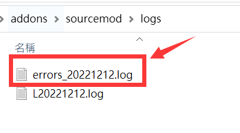
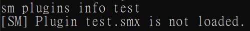
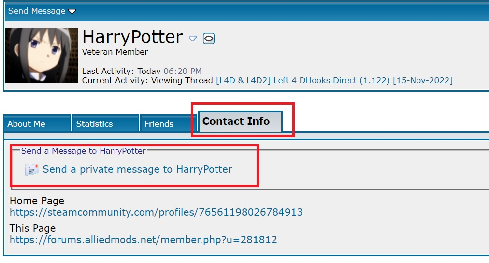
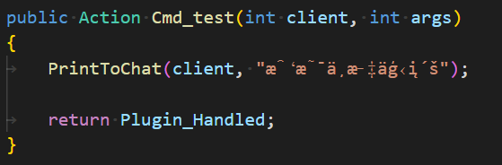
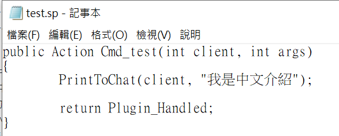
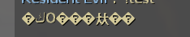
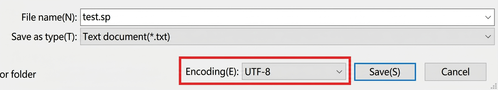

# Plugin Troubleshooting Overview
> Updated on 2025/8/25

- [Troubleshooting Overview](#plugin-troubleshooting-overview)
    - [Prerequisites](#prerequisites)
    - [Why Is the Plugin Not Working?](#why-is-the-plugin-not-working)
    - [Common Plugin Error Messages](#common-plugin-error-messages)
    - [Common Compilation Error Messages](#common-compilation-error-messages)
    - [Can I Modify the Source Code?](#can-i-modify-the-source-code)
    - [Where Can I Ask About Plugin Issues?](#where-can-i-ask-about-plugin-issues)
    - [Can Plugins Have Chinese Language Support?](#can-plugins-have-chinese-language-support)
    - [Why Are Characters Garbled?](#why-are-characters-garbled)
    - [What Happens If I Don't Obtain the Source Code?](#what-happens-if-i-dont-obtain-the-source-code)
    - [What Is the Difference Between Mods and Plugins?](#what-is-the-difference-between-mods-and-plugins)

---

## Prerequisites
> You should review these guides first as they will be referenced below:
* [How to Check Versions](/Tutorial_教學區/English/Server/Install_Dedicated_Server_Plugin/README.md#how-to-check-versions)
* [How to Compile Source Code](/Tutorial_教學區/English/Server/Install_Dedicated_Server_Plugin/README.md#how-to-compile-source-code)
* [How to Install Plugins](/Tutorial_教學區/English/Server/Install_Dedicated_Server_Plugin/README.md#how-to-install-plugins)
* [How to Verify Plugins Are Working](/Tutorial_教學區/English/Server/Install_Dedicated_Server_Plugin/README.md#how-to-check-if-a-plugin-is-working-properly)

---

## Why Is the Plugin Not Working?
> Before complaining to the author that **"the plugin doesn't work,"** perform this self-check:
* <details><summary>Self-Check Procedure (Click to expand)</summary>

  1. If you strictly follow the plugin documentation, it should work. Please verify:
    <br/>✔ You installed the latest version of the plugin.
    <br/>✔ You installed all required files specified in the documentation.
    <br/>✔ You followed all key setup steps in the documentation.
    <br/>✔ You installed any auxiliary files required by the plugin.
    <br/>✔ Your SourceMod version meets the plugin's requirements.

  2. Open the server console and enter `sm plugins info xxxxxx`
      - Replace `xxxxxx` with the plugin file name.
      - Plugin files are located in `addons/sourcemod/plugins` with the `.smx` extension.
        ```php
        ] sm plugins info test
        Filename: test.smx
        Title: [L4D & L4D2] Test
        Author: HarryPotter
        Version: 1.0
        Error: Error detected in plugin startup (see error logs)
        ```
    - Check if `Author` matches the original developer. **If not, the plugin was definitely modified or rewritten by someone else.**
    - Check if `Version` matches the release version stated on the developer's post.
    - Check if there are any listed `Error` messages.

  3. An `Error` indicates the plugin failed to load. Go to the `sourcemod/logs` folder, open the `errors_xxxxx.log` file, read the cause, and try to resolve it.
    <br/>
    - If you cannot understand the error, contact the developer and send the raw error log directly without unnecessary fluff.
    - 🟥 If you modified the source code, be honest about it. When the author sees line numbers that don't match the original file, they will ignore you.
      * <details><summary>Raw Error Log Example (Click to expand)</summary>
        
          Filename: `errors_xxxxx.log`
          ```
          L 03/28/2022 - 02:24:27: [SM] Exception reported: XXXXXXXXXXXXXXXXXXXX
          L 03/28/2022 - 02:24:27: [SM] Blaming: xxxxxxxxxx.smx
          L 03/28/2022 - 02:24:27: [SM] Call stack trace:
          L 03/28/2022 - 02:24:27: [SM]   [0] ThrowNativeError
          L 03/28/2022 - 02:24:27: [SM]   [1] Line 5394, C:\Servers\L4D2\left4dead2\addons\sourcemod\scripting\xxxxxxxxxx.sp::ValidateAddress
          L 03/28/2022 - 02:24:27: [SM]   [2] Line 6131, C:\Servers\L4D2\left4dead2\addons\sourcemod\scripting\xxxxxxxxxx.sp::Native_CDirector_IsAnySurvivorInStartArea
          L 03/28/2022 - 02:24:27: [SM]   [4] L4D_IsAnySurvivorInStartArea
          L 03/28/2022 - 02:24:27: [SM]   [5] Line 172, f:\Stuff\EVERYTHING ELSE\Left 4 Dead 2 Dedicated Servers\left4dead2\addons\sourcemod\scripting\xxxxxxxxxx.sp::OnPluginStart
          ```
      </details>

  4. After reinstalling or fixing the plugin, restart the server and confirm it operates without any log errors.
</details>

* <details><summary>Issue 1: Inspecting the plugin shows: <b>XXX.smx is not loaded.</b></summary>

  <br/>

  * **Cause:** The `.smx` file was not placed in the correct directory.
  * **Solution:** Verify that the `.smx` file is inside the `addons/sourcemod/plugins` directory.
</details>

---

## Common Plugin Error Messages
> * Resolve any errors and restart the server until no error logs remain.
> * If the error persists or you cannot interpret the message, contact the developer directly with the raw log excerpt.

* <details><summary>Error 1: <b>Native XXXXX was not found</b></summary>

  ```php
  [SM] Unable to load plugin "left4dhooks.smx": Native "DHookParam.GetAddress" was not found
  ```

  * **Cause:** Missing dependency or required extension/plugin file.
  * **Solution:** Reinstall all required files specified in the documentation.
</details>

* <details><summary>Error 2: <b>File could not be opened: The system cannot find the file specified.</b></summary>

  ```php
  [SM] Error parsing gameconfig file "D:\Left 4 Dead 2 Test Server\left4dead2\addons\sourcemod\gamedata\all4dead2.txt":
  [SM] Error 1 on line 0, col 0: Stream failed to open
  [SM] Exception reported: Unable to open all4dead2: File could not be opened: The system cannot find the file specified.
  ```

  * **Cause:** Supporting configuration or gamedata files are missing or mislocated.
  * **Solution:** Place translation or auxiliary files into their required directories (verify exact path and file name):
    - Translation `.txt` files belong in `addons/sourcemod/translations`
      <details>
      <summary>How to identify a translation file (Click to expand)</summary>
      Example format:
      
      ```
      "Phrases"
      {
        "You're spectating. Join any team to play."
        {
          "en"	"You're spectating. Join any team to play."
          "zho"	"輸入 !join 加入遊戲..."
          "chi"	"输入 !join 加入游戏..."
        }	
        "[AFK] Inactivity detected! 1"
        {
          "#format"		"{1:d}"
          "en"	"[AFK] Inactivity detected! You'll be moved to spectators in {1} seconds!"
          "zho"	"[AFK] 偵測閒置! 你將於 {1} 秒後強制旁觀."
          "chi"	"[AFK] 探测闲置! 你将于 {1} 秒后强制旁观."
        }	

        ...
      }
      ```
      </details>
      
    - Gamedata `.txt` files belong in `addons/sourcemod/gamedata`
      <details>
      <summary>How to identify a Gamedata file (Click to expand)</summary>
      Example format:
      
      ```
      "Games"
      {
        "left4dead2" //credit: ProdigySim, Shadowysn
        {
          "Addresses"
          {
            "NextBotCreatePlayerBot.jumptable"
            {
              "windows"
              {
                "signature"	"CTerrorPlayer::ReplaceWithBot.jumptable"
                "offset"	"7"
              }
            }
          }
          "Signatures"
          {
            "TakeOverBot"
            {
              "library"	"server"
              "linux"		"@_ZN13CTerrorPlayer11TakeOverBotEb"
              "windows"	"\x55\x8B\xEC\x81\xEC\x2A\x2A\x2A\x2A\xA1\x2A\x2A\x2A\x2A\x33\xC5\x89\x45\xFC\x53\x56\x8D\x85"
              /* 55 8B EC 81 EC ? ? ? ? A1 ? ? ? ? 33 C5 89 45 FC 53 56 8D 85 */
            }
          }
        }

        ...
      }
      ```
      </details>
      
    - Place all other configuration files according to instructions.
</details>

* <details><summary>Error 3: <b>File Not Found</b></summary>

  ```php
  Exception reported: File Not Found: addons\sourcemod\data\l4d_elevator_info.cfg
  ```

  * **Cause:** Same cause as Error 2.
</details>

* <details><summary>Error 4: <b>unsupported feature set; code is too new</b></summary>

  ```php
  [l4d2_supply_woodbox.smx] Unable to load plugin (unsupported feature set; code is too new)
  ```

  * **Cause:** Your SourceMod installation is outdated.
  * **Solution:** Download and install the latest stable version from the [Official SourceMod Website](https://www.sourcemod.net/downloads.php?branch=stable).
</details>

* <details><summary>Error 5: <b>Unable to load plugin (bad header).</b></summary>

  ```php
  [SM] Failed to load plugin "l4dinfectedbots.smx": Unable to load plugin (bad header).
  ```

  * **Cause:** Incompatibility between your installed SourceMod version and the plugin binary build.
  * **Solution:**
    * **Method 1:** Update SourceMod from the [Official SourceMod Website](https://www.sourcemod.net/downloads.php?branch=stable).
    * **Method 2:** Compile the plugin `.sp` source file locally using your installed compiler environment.
</details>

* <details><summary>Error 6: <b>Failed to find signature</b></summary>

  ```php
  [left4dhooks.smx] Failed to find signature: "IsVisibleToPlayer"
  ```

  * **Cause:** The signature in gamedata is invalid or outdated following a game update.
  * **Solution:** Report the error directly to the developer, specifying your operating system (Windows or Linux).
</details>

* <details><summary>Error 7: <b>String formatted incorrectly</b></summary>

  ```php
  [SM] Exception reported: String formatted incorrectly - parameter 6 (total 5)
  ```

  * **Cause:** Incorrect format string arguments inside the source code.
  * **Solution:** Report the issue directly to the developer.
</details>

* <details><summary>Error 8: <b>Plugin only supports XXXX..</b></summary>

  ```php
  [SM] Failed to load plugin "test.smx": Plugin only supports CSGO..
  ```

  * **Cause:** The plugin does not support your target game engine/mod.
  * **Solution:**
    * **Method 1:** Remove the plugin.
    * **Method 2:** Contact the author to request compatibility support for your game.
</details>

* <details><summary>Error 9: <b>incompatible with this game.</b></summary>

  ```php
  [SM] Failed to load plugin "nextmap.smx": Nextmap is incompatible with this game.
  ```

  * **Cause:** The plugin is incompatible with the current game engine (note that bundled SourceMod plugins do not apply universally to every game).
  * **Solution:** Remove the plugin.
</details>

* <details><summary>Error 10: <b>Invalid Entity index</b></summary>

  ```php
  Exception reported: Invalid Entity index -1 (-1)
  ```

  * **Cause:** Improper entity validation handling in the plugin source code.
  * **Solution:** Report the issue directly to the developer.
</details>

* <details><summary>Error 11: <b>is not in game</b></summary>

  ```php
  Exception reported:  Client 11 is not in game
  ```

  * **Cause:** Missing or improper client connected/in-game check in the source code.
  * **Solution:** Report the issue directly to the developer.
</details>

* <details><summary>Error 12: <b>Handle XXXXXX is invalid</b></summary>

  ```php
  Exception reported: Handle 9330066f is invalid
  ```

  * **Cause:** Handle lifecycle issue or invalid object handle reference in code.
  * **Solution:** Report the issue directly to the developer.
</details>

* <details><summary>Error 13: <b>Language phrase XXXXX not found</b></summary>

  ```php
  Exception reported: Language phrase "BAW_3" not found (arg 6)
  ```

  * **Cause:** The translation string phrase key is missing from the translation file.
  * **Solution:**
    1. Ensure the required translation file for the plugin is installed.
    2. Note that the default server language is English (`"ServerLang" "en"` in `addons/sourcemod/configs/core.cfg`). Modifying this default is generally not recommended.
    3. If the phrase error persists, report it to the author.
</details>

---

## Common Compilation Error Messages
> * Follow the [standard local compilation steps](/Tutorial_教學區/English/Server/Install_Dedicated_Server_Plugin/README.md#how-to-compile-source-code). Do not rely on third-party online web compilers.
> * If compilation fails on unedited original source code, send the raw error log to the developer.
> * If the error occurs on code you modified, original developers will generally not debug it for you; you will need to inspect the code or seek advice in community forums.

> __Note__ 
> <br/>Compiler outputs starting with `warning` can generally be ignored. If desired, report them to the developer for clean code upkeep.

* <details><summary>Warning 1: <b>symbol is assigned a value that is never used</b></summary>

  ```php
  test.sp(34) : warning 204: symbol is assigned a value that is never used: "ZC_TANK"
  ```

  * **Cause:** Unused variable assignment.
  * **Solution:** Safe to ignore.
</details>

* <details><summary>Warning 2: <b>should return an explicit value</b></summary>

  ```php
  test.sp(55) : warning 242: function "Cmd_test" should return an explicit value
  ```

  * **Cause:** Function path missing explicit return value.
  * **Solution:** Safe to ignore.
</details>

* <details><summary>Warning 3: <b>inconsistent indentation</b></summary>

  ```php
  test.sp(42) : warning 217: inconsistent indentation (did you mix tabs and spaces?)
  ```

  * **Cause:** Mixed tabs/spaces or misaligned code formatting.
  * **Solution:** Safe to ignore.
</details>

* <details><summary>Warning 4: <b>tag mismatch</b></summary>

  ```php
  test.sp(58) : warning 213: tag mismatch (expected "float", got "int")
  ```

  * **Cause:** Variable type mismatch.
  * **Solution:** Safe to ignore, though reporting to the developer is recommended.
</details>

* <details><summary>Error 1: <b>cannot read from file</b></summary>

  ```php
  test.sp(9) : error 417: cannot read from file: "multicolors"
  ```

  * **Cause:** Missing required include file (`.inc`).
  * **Solution:** Install the required include file inside `addons/sourcemod/scripting/include`.
</details>

* <details><summary>Error 2: <b>new-style declarations are required</b></summary>

  ```php
  test.sp(55) : error 147: new-style declarations are required
  ```

  * **Cause:** Legacy SourcePawn syntax structure. SourceMod introduced major syntax revisions in 1.7+; legacy code may fail to compile on modern compilers.
  * **Solution:** Report to the author or rewrite the syntax to transitional/new SourcePawn standard.
</details>

* <details><summary>Error 3: <b>expected token: ";"</b></summary>

  ```php
  test.sp(42) : error 001: expected token: ";", but found "return"
  ```

  * **Cause:** Missing semicolon `;` delimiter at line end.
  * **Solution:** Report to the author or fix syntax.
</details>

* <details><summary>Error 4: <b>undefined symbol XXXXXXX</b></summary>

  ```php
  test.sp(57) : error 017: undefined symbol "CPrintToChat"
  ```

  * **Cause:** Non-existent or undeclared function/variable name (missing include or syntax typo).
  * **Solution:** Report to the author.
</details>

---

## Can I Modify the Source Code?
* <details><summary>Explanation (Click to expand)</summary>

  * SourceMod source code open-source standards encourage editing and re-sharing to expand gameplay features.
  * You are free to edit downloaded source code for personal customizations, translations, or bug fixes.
  * Always preserve original author credits. Removing author tags or claiming ownership of another person's work is unethical.
  * Note that if you encounter bugs after editing source code, **most original authors will decline support**.
  * When seeking programming assistance in developer forums, always provide the modified `.sp` file for context.
</details>

---

## Where Can I Ask About Plugin Issues?
* <details><summary>Explanation (Click to expand)</summary>

  * **English Community:** [AlliedModders](https://forums.alliedmods.net/index.php) (Account registration recommended)
    * Primary English community platform. Make sure to post under SourceMod rather than AMX Mod X:
      * [Plugin Requests / Ideas](https://forums.alliedmods.net/forumdisplay.php?f=60): Post new concepts or requests.
      * [General Discussion](https://forums.alliedmods.net/forumdisplay.php?f=58): Server administration and plugin discussions.
      * [SourceMod Scripting](https://forums.alliedmods.net/forumdisplay.php?f=107): Coding and source code development help.
    * For existing plugins, post issues directly in the original release thread.
    * To request direct assistance privately, send a Private Message (PM) via the author's profile.
      <br/>

  * **Chinese Community:** QQ Groups, Baidu Tieba, Bahamut, Bilibili.
    * Bilibili contains many active community developers showcasing video demonstrations of custom plugins.
</details>

* <details><summary><b>Unspoken Rule</b></summary>
    
  Offering paid compensation significantly increases response rate when requesting custom plugins or script fixes.
</details>

---

## Can Plugins Have Chinese Language Support?
* <details><summary>Explanation (Click to expand)</summary>

  * SourceMod relies strictly on English for console execution, command parsing, and config file definitions:
    * Plugin filenames and internal identifiers cannot use non-ASCII Chinese characters.
    * Command descriptions and default parameter values must remain in English.
    * Config files (`.cfg`) parsed by plugins must not contain non-ASCII annotations or Chinese encoding in keys.
    * English is the required baseline; non-ASCII input in core execution files risks unpredictable crashes.
    * 🟥 Server instability or outright crashes can occur if internal engine configs read non-UTF8 or unsupported characters.
  * User-facing text output (chat messages, menus, hint text) fully supports multilingual strings (including Traditional/Simplified Chinese):
    * Use translation files (`addons/sourcemod/translations`) or developer-supported translation structures to output localization strings safely.
</details>

---

## Why Are Characters Garbled?
* <details><summary>Question 1: File contents display garbled text</summary>

  

  * **Cause:** Incorrect file character encoding.
  * **Solution:** Ensure the text file is saved with **UTF-8** encoding (or UTF-8 without BOM). You can select UTF-8 when saving via Notepad/text editors.
  <br/>
</details>

* <details><summary>Question 2: File looks normal on desktop, but shows garbled characters in-game</summary>

  Chinese text displays fine in text editor, compiles without error, installed according to instructions without plugin log errors, yet in-game text appears corrupt.
  <br/>
  <br/>

  * **Cause:** File encoding mismatch.
  * **Solution:** Re-save the source `.sp` or translation `.txt` file explicitly set to **UTF-8** encoding.
  <br/>
</details>

* <details><summary>Question 3: Simplified Chinese text fails to display</summary>

  Simplified Chinese appears as garbled symbols.
  * **Cause:** Operating system font/locale environment lacks Simplified Chinese rendering support.
  * **Solution:** Add Simplified Chinese language support within OS System Settings.
</details>

---

## What Happens If I Don't Obtain the Source Code?
* Source code uses the `.sp` extension, while compiled binaries use `.smx`. Compiling plugins locally from source ensures full build compatibility with your specific SourceMod version.
  * Compiling locally guarantees binary compatibility with your installed SourceMod engine build.
  * Compilation errors highlight underlying code incompatibilities immediately before deployment.

* <details><summary>What are the risks of using binary `.smx` files without `.sp` source files?</summary>

  **Answer:** Potential maintenance issues and stability risks.
   <details><summary>Scenario 1: Compatibility breakages on newer updates</summary>

    * Plugins compiled years ago may fail or cause unexpected crashes under modern engine/SourceMod updates.
    * Without source code, minor syntax fixes or API updates cannot be applied.
  </details>

  <details><summary>Scenario 2: Server lag and outdated code structures</summary>

    * Legacy SourcePawn code often relies on inefficient workarounds.
    * Modern SourceMod versions (1.11+) introduce optimized extensions like DHooks, VoiceHook, and GeoIPCity to reduce crash risks and CPU overhead.
    * Access to source code allows developers to refactor outdated logic for modern performance benefits.
  </details>

  <details><summary>Scenario 3: Inability to fix bugs or add features</summary>

    * Requesting community support for a binary without source code is ineffective; developers cannot fix compiled `.smx` binaries directly.
    * Re-creating plugins from scratch is costly and time-consuming.
    * Decompiled code produces obfuscated output that is difficult to maintain compared to original clean source code.
  </details>

  <details><summary>Scenario 4: Limited customization and translation</summary>

    * Without source code or translation phrase links, hardcoded chat strings or menu commands cannot be localized or adjusted.
  </details>

  <details><summary>Scenario 5: Malicious code and backdoors</summary>

    * Closed-source binaries can conceal server crash routines, unauthorized admin backdoors, or malicious server-redirect commands.
  </details>

  <details><summary>Scenario 6: Lack of author identification</summary>

    * Uncredited binary distribution makes tracing the original developer difficult, impeding official bug reports and updates.
  </details>
</details>

* <details><summary>What if an author provides `.smx` without `.sp` source code?</summary>

  * According to SourceMod's licensing agreement (GPLv3), anyone providing a .smx file is required to provide the .sp source file as well. But honestly, who cares about what the licensing agreement says.
  <br/>
  * Do whatever you can to get your hands on the source code to avoid headaches down the line. If people are willing to pay for it, great.
  * But if the author refuses to provide the source code no matter what, just don't use the plugin. It's much better to stick with plugins that include source code than to get ripped off.
</details>

* <details><summary>Summary</summary>

  1. Avoid installing untrusted binaries from unverified sources.
  2. Avoid closed-source plugins lacking `.sp` files.
  3. Keep track of original author attribution for every source file.
  4. Always attach `.sp` source code when requesting development assistance in forums.
  5. Backup all retrieved source code files.
</details>

---

## What Is the Difference Between Mods and Plugins?

| Feature | Mod | Plugin |
| :--- | :---: | :---: |
| **Term** | Mod | Plugin |
| **File Extension** | `.vpk` | `.smx` |
| **Source** | Steam Workshop subscriptions, custom weapon skins, or third-party custom campaign downloads | Downloaded custom scripts written by community developers |
| **Code Architecture** | Select mods utilize Source VScript scripting | Written in SourcePawn programming language |
| **Installation** | Subscribed via Workshop or placed into the `addons` folder | Requires SourceMod core framework installed on server |
| **Impact Scope** | Modifies client-side game assets | Modifies server-side game mechanics and rules |
| **Primary Domain** | Custom models, player characters, weapon skins, UI textures, custom maps | Alters game mechanics, survivor limits (e.g., 9+ survivor campaigns, 10v10 Versus) |
| **Target Audience** | Affects only clients with the mod installed; unequipped players remain unaffected | Affects all connected players on the server automatically, without requiring client downloads |
| **Local / Listen Server** | 99% of client mods function in local host sessions | Selected plugins do not support Listen Server mode |
| **Dedicated Server** | Limited mod types supported on dedicated servers | 100% of plugins support Dedicated Server environments |
| **Compatibility** | High chance of conflicts between overlapping asset mods | High compatibility; multiple plugins can interact via shared natives/hooks |
| **Crash Debugging** | Mod crashes rarely generate error logs, making troubleshooting difficult | 🟦 Plugin errors output detailed stack traces and error log files for easy debugging |

* <details><summary>Summary & Recommendations</summary>

    1. 🟥 Dedicated servers should prioritize plugins over client mods; minimize server-side mod installations whenever possible.
    2. 🟦 Optimal setup: Install plugins and custom maps server-side, while players handle personal skin/character/weapon mods client-side.
</details>

* <details><summary>Question 1: If I put a custom map on the server, will clients download it automatically?</summary>

    * No. Players must download custom campaign maps independently prior to joining or via external fast-download setup.
</details>

* <details><summary>Question 2: If I put a character skin mod on the server, will all players see it?</summary>

    * No. To view specific custom client models, each player must have the matching mod installed on their client.
</details>

* <details><summary>Question 3: Can I install various custom weapon/skin mods directly onto the server?</summary>

    * Not recommended. Server-side asset mods frequently induce instability or engine crashes.
</details>

* <details><summary>Question 4: Do mods cause server crashes?</summary>

    * Poorly authored mods or maps with faulty VScripts carry a high crash risk.
    * Malformed third-party campaign scripts can disrupt server memory execution.
    * When encountering unexplained crashes, disable custom maps and client mods to isolate the issue.
</details>