# Troubleshooting Overview
> Updated on 2025/8/25

- [Troubleshooting Overview](#troubleshooting-overview)
    - [Why Can't I Join the Server?](#why-cant-i-join-the-server)
    - [Why Are There Two Types of SourceMod Downloads?](#why-are-there-two-types-of-sourcemod-downloads)
    - [Why Can't I Launch the Game After Starting the Server?](#why-cant-i-launch-the-game-after-starting-the-server)
    - [Does SourceMod Support Local/Listen Servers?](#does-sourcemod-support-locallisten-servers)

---

## Why Can't I Join the Server?

* 

Issue 1: Console displays <b>Invalid host version, expecting 2226, got 2225</b>

    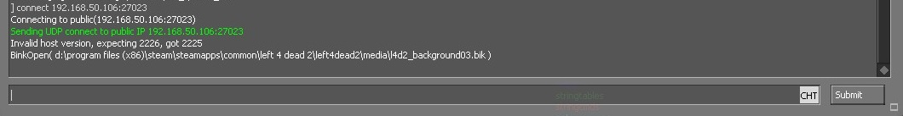

    * **Cause:** The game version does not match the server version.
    * **Solution:** Ensure both your game and server are updated to the latest version.
        * Game: [Verify Integrity of Game Files](/Tutorial_教學區/English/Game/README.md#verifying-integrity-of-game-files)
        * Server: [Update Dedicated Server](/Tutorial_教學區/English/Server/Install_Dedicated_Server_Plugin/README.md#how-to-update-a-dedicated-server)

* 

Issue 2: Console displays <b>RememberIPAddressForLobby: lobby xxxx from address xxxxx, lobby response</b>

    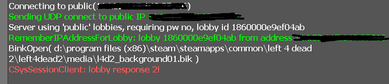

    * **Cause:** Official bug. The server is occupied by matchmaking, but you find no players inside.
    * **Solution:**
        1. [Install l4dtoolz](/Tutorial_教學區/English/Server/Install_Other_File/README.md#l4dtoolz).
        2. Make sure the file `cfg/server.cfg` (create one if it doesn't exist) contains the required commands, then restart the server.
        3. Restart the server and [matchmake from lobby](/Tutorial_教學區/English/Server/Install_Dedicated_Server_Plugin/README.md#how-to-matchmake-into-a-dedicated-server-from-lobby).
            * If the same message appears and fails, ask a friend to host a lobby and matchmake instead.

* 

Issue 3: Screen displays <b>connection failed after 10 retries</b>

    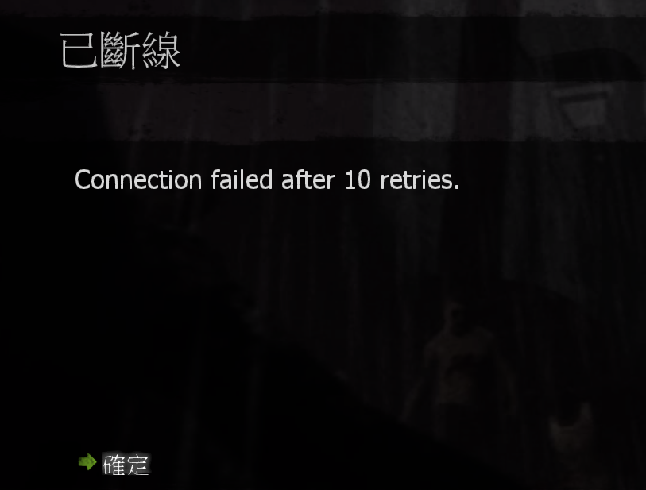

    * **Cause:** Server cannot be found.
    * **Solution:** Verify that the server is online and accessible via a public IP (not a virtual/LAN IP). Ensure external network connections to this public IP are allowed.
    * [How to Join My Server](/Tutorial_教學區/English/Server/Install_Dedicated_Server_Plugin/README.md#how-to-join-my-server)

* 

Issue 4: Screen displays <b>Server is enforcing consistency for this file</b>

    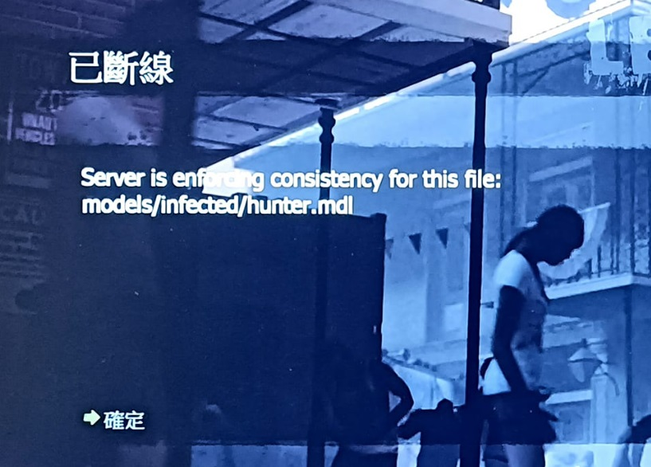

    * **Cause:** Mod conflicts or too many custom maps; the server files do not match your client files.
    * **Solution:**
        * **Method 1:** Delete your mods or custom maps.
        * **Method 2:**
            * For local host (Listen Server): The host enters `sv_consistency 0` in the game console.
            * For Dedicated Server: Enter `sv_consistency 0` into the server console.
            * If you created a lobby yourself: Open the game console and enter `sv_consistency 0`.

* 

Issue 5: Console already ran <b>sv_consistency 0</b>, but screen still displays <b>Server is enforcing consistency for this file</b>

    

    * **Cause:** Too many file conflicts that cannot be ignored; the game client cannot recover.
    * **Solution:** Delete all mods/custom maps and [Verify Integrity of Game Files](/Tutorial_教學區/English/Game/README.md#verifying-integrity-of-game-files).

* 

Issue 6: Connection blocked, screen displays <b>steam please remove "-insecure" from the launch options...</b>

    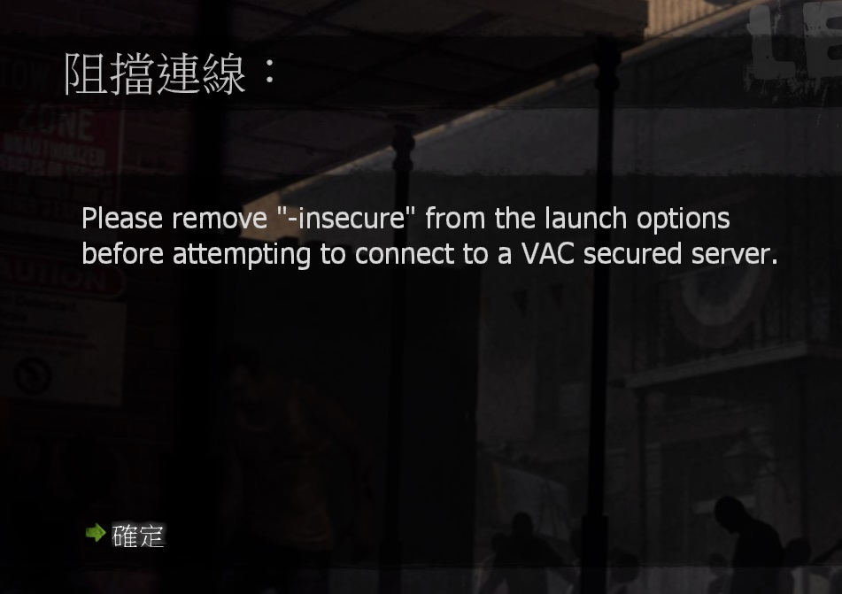

    * **Cause:** You have `-insecure` in your launch options, which prevents you from joining VAC-secured servers.
    * **Solution:** Go to your [Launch Options](/Tutorial_教學區/English/Game/README.md#setting-launch-options) and remove `-insecure`.

* 

Issue 7: Disconnected, screen displays <b>No Steam Logon</b>

    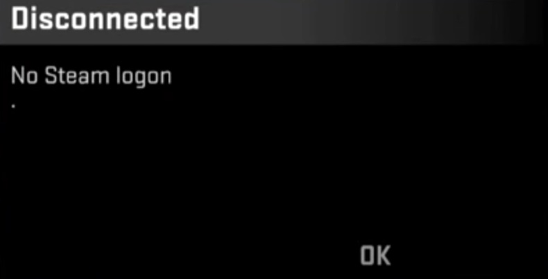

    * **Cause:** After connecting, the server sends your client info to Steam servers for verification (checking for legitimate/pirated account, network abnormalities, ban status, etc.).
         If Steam fails to verify or identify your account, the server kicks you. This issue even happens during [CS:GO professional matches](https://www.youtube.com/watch?v=YfIeQCEGglc), and is usually network-related.
        1. 1% chance: Network issue between player and Steam; 99% chance: Steam server issue.
        2. Steam is not logged in or got signed out.
        3. You are not using an official game copy.
        4. Player or server IP address changed mid-session.
        5. Network incompatibility (e.g., overseas players joining Mainland China servers getting dropped by the firewall).
    * **Solution:**
        1. Exit the game, reconnect your network, make sure connection is stable, and restart Steam.
        2. Install the [latest l4dtoolz](/Tutorial_教學區/English/Server/Install_Other_File/README.md#l4dtoolz), and add `sv_steam_bypass 1` to `cfg/server.cfg`. *Note: Enabling this reduces server security and disables Family Sharing restrictions, but significantly reduces "No Steam Logon" occurrences.*
        3. If it still fails, submit a complaint to Steam/Valve.

* 

Issue 8: Disconnected, screen displays <b>STEAM UserID STEAM_XXXXXXXXX is banned</b>

    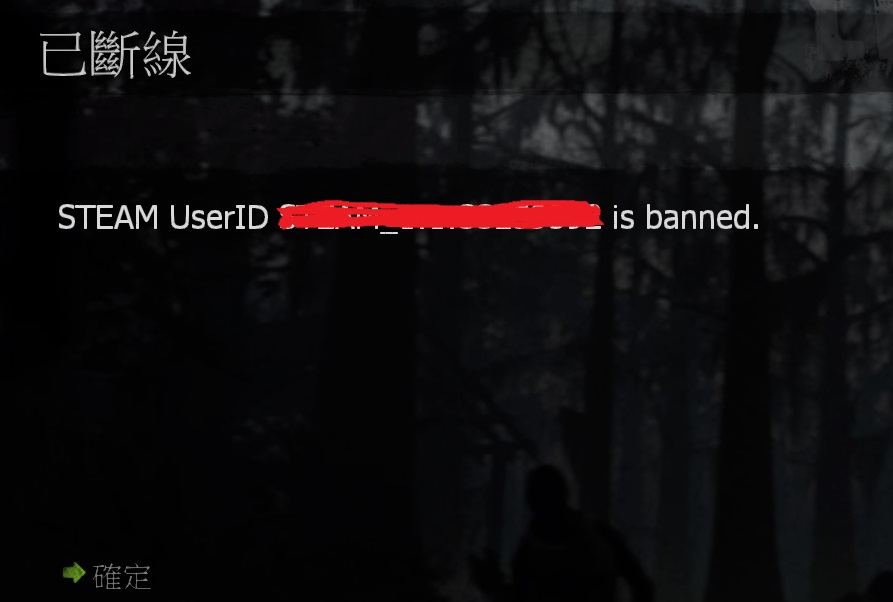

    * **Cause:** You have been blacklisted/banned by the server.
    * **Solution:** Accept your fate or appeal directly to the server administrator.

* 

Issue 9: Disconnected, screen displays <b>Map does not match the version on the server</b>

    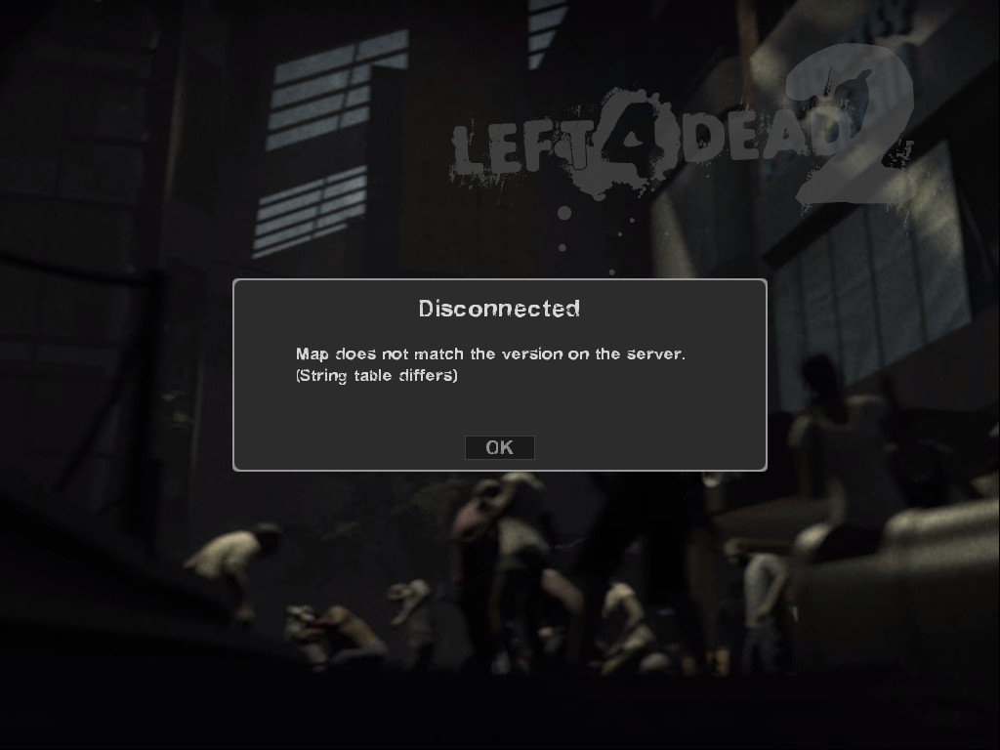

    * **Cause:** Your map version differs from the server's map version.
    * **Solution:** Ensure your map version matches the server's map version. The best approach is downloading the map from the same website or Steam Workshop page.

* 

Issue 10: Disconnected, screen displays <b>STEAM validation rejected</b>

    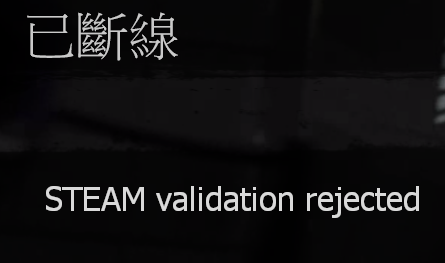

    * **Cause 1:** Both your game and dedicated server are running on the same PC, confusing the Steam client platform.
        * **Solution:**
        * **Method 1:** Use a separate computer for the dedicated server, preferably on a different network connection.
        * **Method 2:** Add `-insecure` to server launch options (Note: this disables VAC protection for your server) -> Delete the `steam_appid.txt` file from the server's root folder -> Steam won't treat L4D2 as running twice -> Launch the server first -> Launch the game second.
         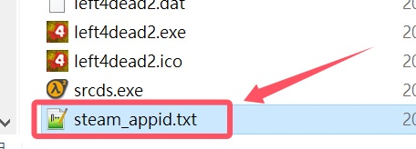
         If **STEAM validation rejected** still appears -> Restart Steam and game -> Join server room directly.

    * **Cause 2:** Steam account authentication failed, Steam is offline, or network connection changed.
        * **Solution:** Restart Steam client and sign back in.

    * **Cause 3:** Your Steam account is already active inside the server. This usually happens when your game crashed or disconnected, but your ghost entity is still stuck inside the server.
        * **Solution:**
        * **Method 1:** Ask the server admin to kick your ghost entity.
        * **Method 2:** Restart the server.
        * **Method 3:** Wait for the server to auto-kick the ghost entity (servers periodically check for unresponsive client network data).

    * **Cause 4:** You are playing Single Player in Offline Mode, but the server keeps demanding online Steam account authentication.
        * **Solution:** Open game console and enter `sv_lan 1`.

* 

Issue 11: Disconnected, screen displays <b>LAN servers are restricted to local clients (Class C)</b>

    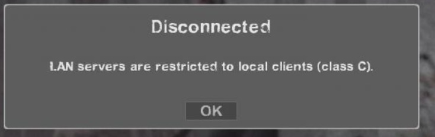

    * **Cause:** The server restricts access to players on the same local subnet/network.
    * **Solution:**
        1. Check server console/backend to ensure `sv_lan` is set to `0`.
        2. Close the server. When launching the [Dedicated Server](/Tutorial_教學區/English/Server/Install_Dedicated_Server_Plugin/README.md#how-to-run-a-dedicated-server), make sure the network mode is set to **Internet**.
        3. Check `cfg` files to ensure `sv_lan` is not being overridden.
        4. If launching via command line parameters, add `+sv_lan 0`.

* 

Issue 12: Disconnected, screen displays <b>The session is no longer available</b> or <b>server requires lobby reservation but is unreserved.</b>

    * Different error display formats:
     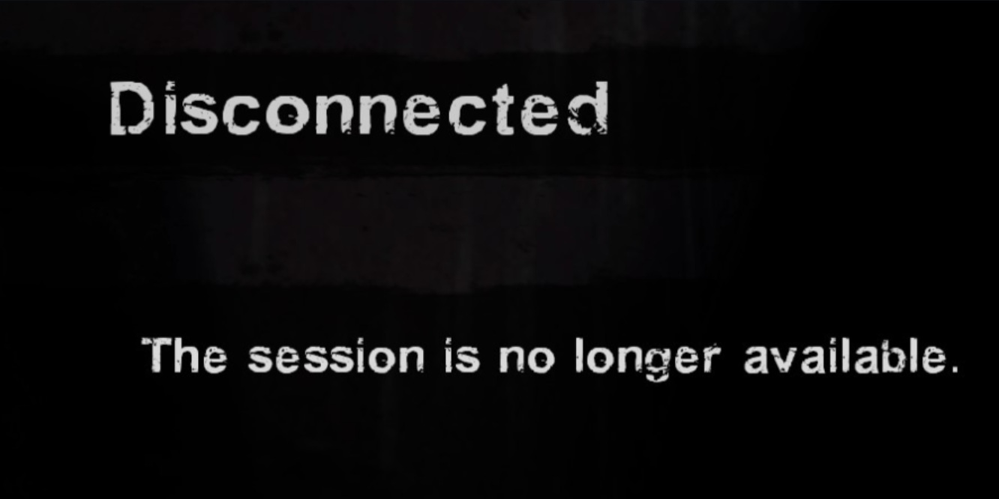
     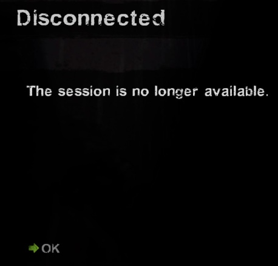
     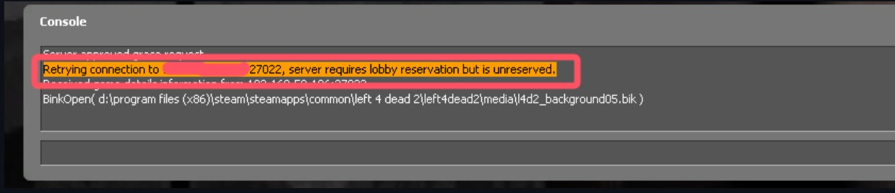

    * **Cause:** The client requested dynamic lobby cookies validation during connection, but the dynamic lobby cookies have been removed.
    * **Solution:**
        1. [Install l4dtoolz](/Tutorial_教學區/English/Server/Install_Other_File/README.md#l4dtoolz).
        2. Ensure the file `cfg/server.cfg` (create one if missing) includes the command, then restart the server.
        3. Ensure the plugin `l4d_unreservelobby` is installed.

* 

Issue 13: Disconnected, screen displays <b>Failed to join session because the session did not have enough open slots</b>

    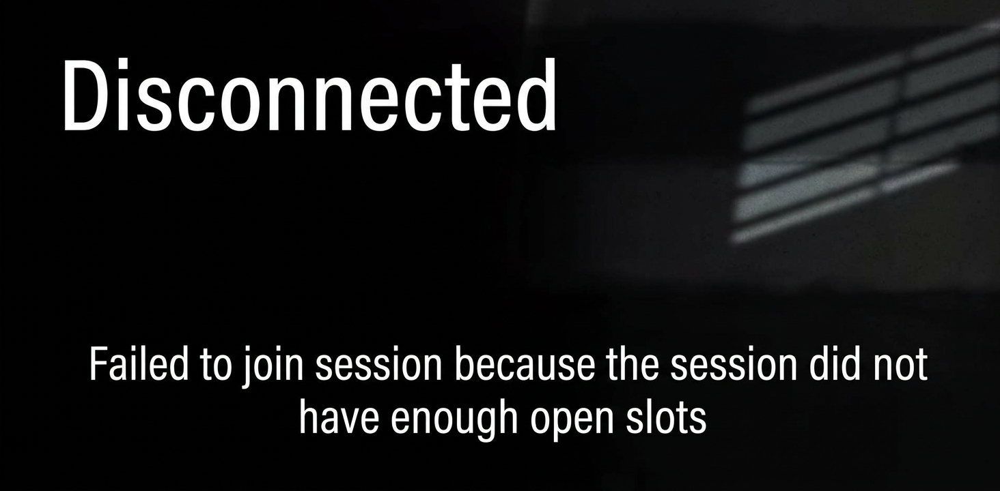

    * **Cause:** Server is full (Versus/Scavenge: max 8 players; Campaign/Survival/Realism: max 4 players). 9th player or above cannot join.
    * **Solution:**
        1. [Install l4dtoolz](/Tutorial_教學區/English/Server/Install_Other_File/README.md#l4dtoolz).
        2. Ensure the file `cfg/server.cfg` (create one if missing) includes the required command, then restart the server.
        3. Ensure the plugin `l4d_unreservelobby` is installed.
        4. Ensure the server's maximum player limit is not reached.

* 

Issue 14: Cannot enter game, loading freezes halfway, console displays <b>Downloading http://........</b>

    

    * **Cause:** The server has custom content files that you lack, so the server forces you to download them.
    * **Solution:**
        * **Method 1:** Options -> Multiplayer -> Custom Server Content -> None.
         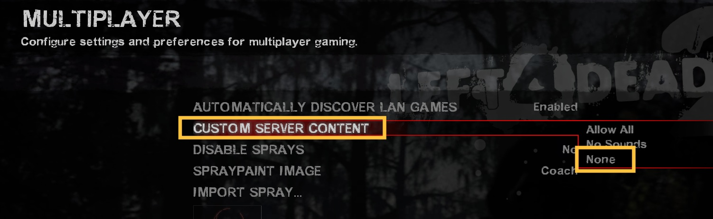
        * **Method 2:** Wait for the download to complete.
        * **Method 3:** Switch to another server.

* 

Issue 15: Cannot enter game, loading gets stuck halfway and stops responding

    * **Cause 1:** Too many mods or custom maps installed.
    * **Cause 2:** Corrupted game files.
    * **Solution:** Remove all mods/custom maps, then [Verify Integrity of Game Files](/Tutorial_教學區/English/Game/README.md#verifying-integrity-of-game-files).

* 

Issue 16: I have too many mods/maps and can't join games, but I don't want to delete them. What should I do?

    If you refuse to delete your mods or custom maps, nobody can help you. Play Single Player mode instead.

---

## Why Are There Two Types of SourceMod Downloads?

* 

Explanation (Click to expand)

    The official websites for [SourceMod](https://www.sourcemod.net/downloads.php) and [MetaMod](https://www.sourcemm.net/) offer **Stable Builds** and **Dev Builds**.
     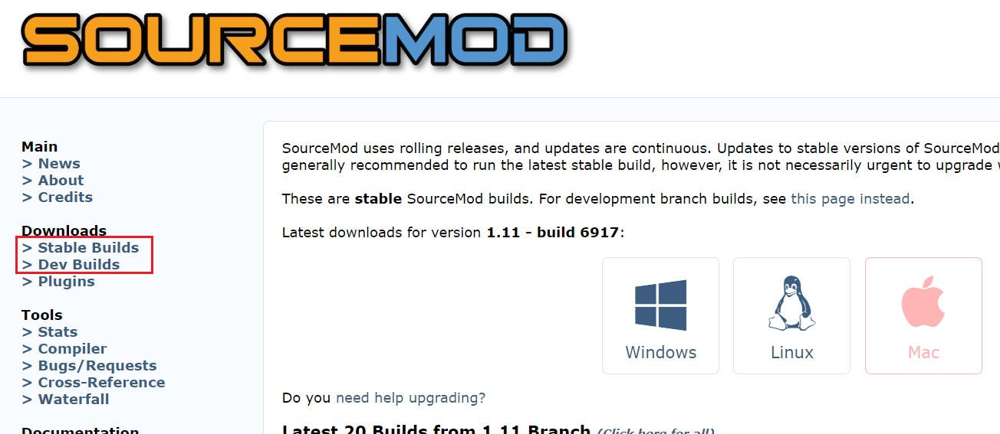
     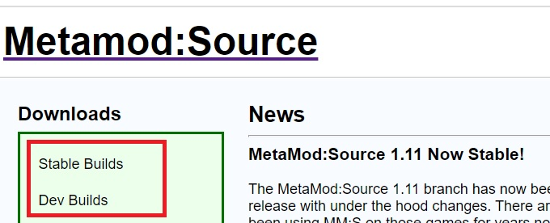
    * **Stable Builds**
        * 🟦 **Recommended**
        * Released after thorough testing by the SourceMod team with no critical bugs.
        * High stability; server is far less prone to crashes.
        * Most plugin developers compile source code using Stable Builds.
        * Recommended to run the latest stable build, updating every 6 months.
        * No need to rush updates as long as your server functions smoothly.

    * **Dev Builds**
        * 🟥 **Not Recommended**
        * Still in experimental/testing phases while the SourceMod team works on new features.
        * Might contain new features, but those are primarily for plugin developers to test.
        * Unstable and error-prone. Only install if you want your server to act as a test guinea pig.

---

## Why Can't I Launch the Game After Starting the Server?

* 

Explanation (Click to expand)

    Even though I launched Left 4 Dead 2 Dedicated Server, Steam shows I am playing Left 4 Dead 2 and won't let me launch the game.
     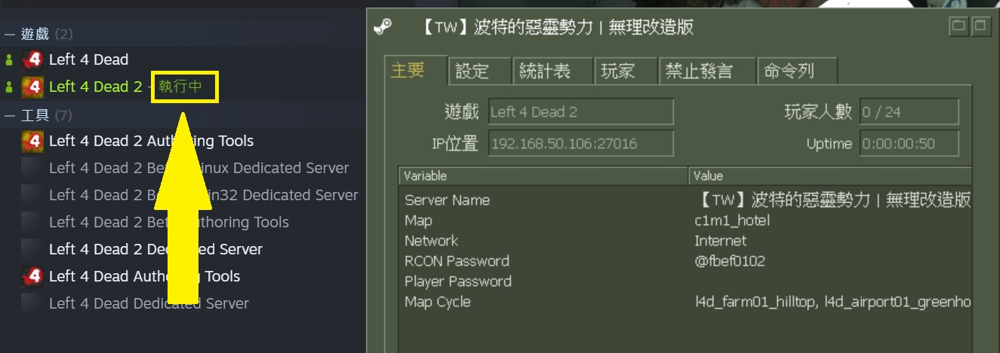

    * **Cause:** A known Steam platform / Left 4 Dead issue that has remained unfixed since game release.
    * **Solution:**
    * **Method 1:** Use a separate computer to host the dedicated server.
    * **Method 2:** Delete the `steam_appid.txt` file from the Dedicated Server root directory -> Start Dedicated Server.
     

---

## Does SourceMod Support Local/Listen Servers?
> A local host server is also known as a Listen Server.

* **NOT Supported.** Although [Official SourceMod Documentation](https://wiki.alliedmods.net/Installing_SourceMod_(simple)) repeatedly emphasizes that SourceMod cannot run on Listen Servers, many users still install SourceMod on local hosts to play with friends.
* It is strongly recommended to [Install SourceMod on a Dedicated Server](/Tutorial_教學區/English/Server/Install_Dedicated_Server_Plugin/README.md). All plugins support dedicated servers and run much more stably. See [Key Differences vs Dedicated Servers](/Tutorial_教學區/English/Server/Install_Local_Server_Plugin/README.md#what-is-the-difference-between-a-listen-server-and-a-dedicated-server).

* 

Why is it unsupported?

    * In a Listen Server, you act as both player and host server simultaneously. This causes execution issues for many plugins, especially voice-chat related plugins.
    * Linux systems cannot run SourceMod on Listen Servers at all.

* 

What happens if I install too many plugins on a local server?

    * Listen Servers have limited hardware resources. Excess plugins cause severe lag, as the base game was designed for casual host sessions rather than dedicated server workloads.
    * Some plugins do not support Listen Servers. Forcing them to load will fail and lag the server further.
    * Most plugin developers will not provide support for Listen Server plugin issues unless replicated on a Dedicated Server.

* 

Why do some people still set up Listen Servers?

    * **Reason 1: Simple & Easy Operation**
        * Hosting a Listen Server requires minimal technical knowledge or network port forwarding.
    * **Reason 2: Casual Play with Friends**
        * Requires minimal plugins. Base SourceMod features like map-changing, kicking, and slaying are sufficient for quick casual sessions.
    * **Reason 3: Plugin Development & Testing**
        * Plugin developers occasionally use Listen Servers for rapid local testing of custom code.
    * **Reason 4: Game Research & Practice**
        * Players open host sessions to test mechanics or practice skills efficiently using SourceMod commands:
        1. Spawning Tanks to analyze attack patterns and practice counter-strategies.
        2. Studying map routes and practicing speedruns.
        3. Practicing high-pounce maneuvers as a Hunter.
        4. Developers generating navigation meshes (`nav`) or testing custom maps.

