# Overview of Questions
> Updated 2025/8/24
- [Overview of Questions](#overview-of-questions)
  - [How to Enable the Game Console](#how-to-enable-the-game-console)
  - [How to Open the Main Game Directory Folder](#how-to-open-the-main-game-directory-folder)
  - [Setting Up Your Own CFG](#setting-up-your-own-cfg)
  - [Setting Launch Options](#setting-launch-options)
  - [Verifying Integrity of Game Files](#verifying-integrity-of-game-files)
  - [Enabling the Game Instructor System](#enabling-the-game-instructor-system)
  - [Downloading Custom Server Content](#downloading-custom-server-content)

- - - -
## How to Enable the Game Console
* <details><summary>Instructions (Click to expand)</summary>

    - Launch the game, go to Options -> Keyboard / Mouse -> Allow Developer Console -> Enabled.
    - Settings may vary across different games.
    <br/>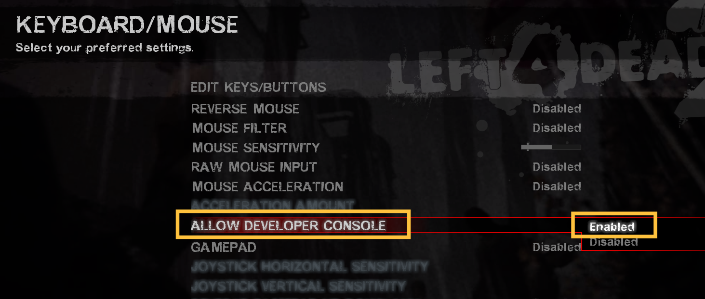
    - Press the `~` key (top-left corner of the keyboard) to open the console.
    <br/>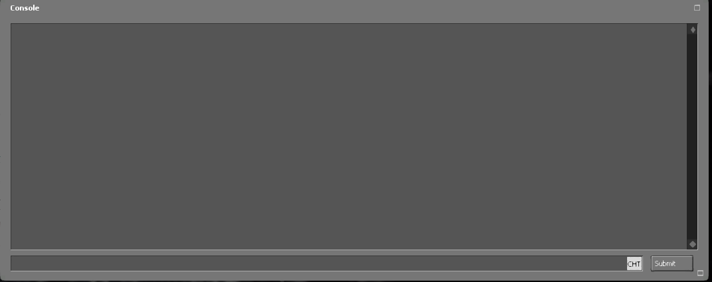

    > __Note__ This is a different concept from the server console/backend.<br/>
</details>

- - - -
## How to Open the Main Game Directory Folder
* <details><summary>Instructions (Click to expand)</summary>

    * Follow the instructions shown in the image to locate the main directory of the game client.
    <br/>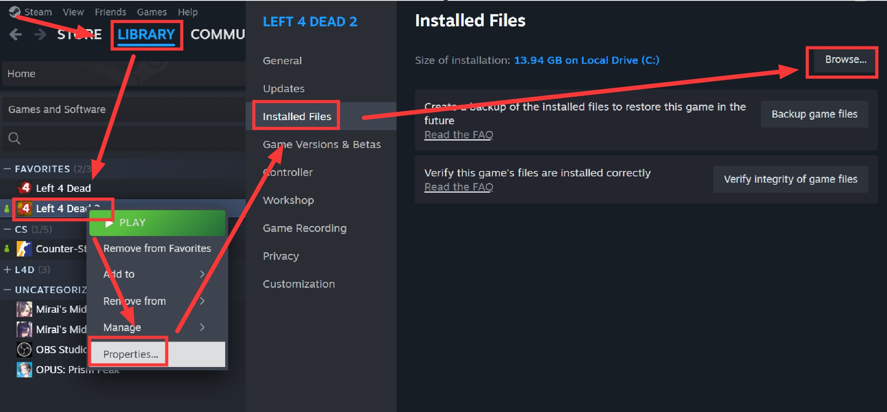
</details>

- - - -
## Setting Up Your Own CFG
* <details><summary>Instructions (Click to expand)</summary>

    * Official games provide many commands for players to use. If you don't want to re-enter them in the console every time you start the game, writing these commands into a `.cfg` file is essential.
        * [L4D Cvars](https://developer.valvesoftware.com/wiki/List_of_L4D_Cvars)
        * [L4D2 Cvars](https://developer.valvesoftware.com/wiki/List_of_L4D2_Cvars)
        * [CSS Cvars](https://developer.valvesoftware.com/wiki/List_of_CS:S_Cvars)
        * [CSGO Cvars](https://developer.valvesoftware.com/wiki/List_of_CS:GO_Cvars)
        * Search online for other games.

    * Find the `cfg` folder in the game's main directory. `autoexec.cfg` is a file that automatically executes every time the game launches.
        * It will automatically execute all commands inside it upon startup.
        <br/>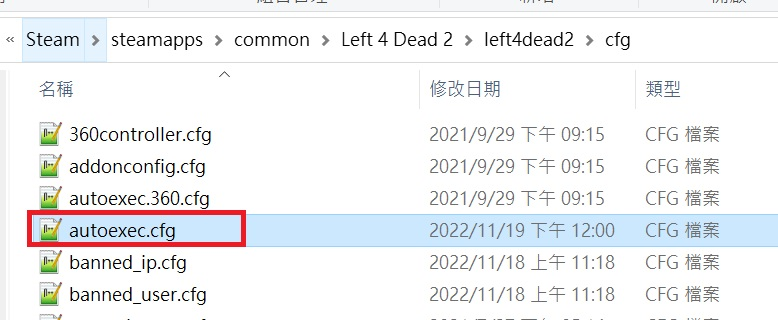

    * You can also create a new file yourself:
        1. Create a file inside the `cfg` folder and rename it to `XXX.cfg` (replace `XXX` with any name you like).
            * Make sure the file extension is `.cfg`.
            <br/>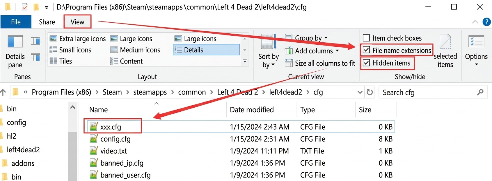
        2. Write the desired commands into the newly created file. After launching the game, enter `exec xxx.cfg` in the console.
        <br/>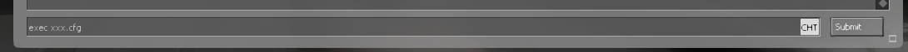
</details>

* <details><summary>My autoexec.cfg Example (Click to expand)</summary>

    ```php
    c_thirdpersonshoulder "1"
    c_thirdpersonshoulderaimdist "720"
    c_thirdpersonshoulderdist "41"
    c_thirdpersonshoulderheight "0"
    c_thirdpersonshoulderoffset "20"
    cam_collision "1"
    cam_ideallag "4"
    cl_viewmodelfovsurvivor "65"
    net_graph "4"
    net_graphheight 0
    mat_monitorgamma_tv_enabled 0
    mat_monitorgamma 1.6
    crosshair 1
    voice_loopback 1
    cl_glow_ghost_infected_g 1; cl_glow_ghost_infected_r 1
    bind "[" "say_team /boss"
    bind "]" "say_team /cur"
    bind "1" "+left"
    bind "2" "+right"
    bind "kp_end" "slot1"
    bind "kp_downarrow" "slot2"
    bind "kp_pgdn" "slot3"
    bind "kp_leftarrow" "slot4"
    bind "kp_5" "slot5"
    bind "kp_rightarrow" "slot6"
    bind "kp_home" "slot7"
    bind "kp_uparrow" "slot8"
    bind "kp_pgup" "slot9"
    bind "kp_ins" "slot0"
    bind "/" "say_team /admin"
    bind "MOUSE3" "+zoom;firstperson"
    bind "F9" "record last_play"
    bind "F10" "stop"
    bind "v" "+mouse_menu v"
    bind "\" "say !forcepause"
    bind TAB "+score"
    alias "lerp_0" "rate 100000;cl_cmdrate 101;cl_updaterate 101;cl_interp 0.0;cl_interp_ratio -1;alias lerp_change lerp_16.7;echo Lerp set to 0 (rate 100000, cl_cmdrate 101, cl_updaterate 101, cl_interp 0.0, cl_interp_ratio -1).";
    alias "lerp_16.7" "rate 100000;cl_cmdrate 101;cl_updaterate 101;cl_interp 0.0167;cl_interp_ratio -1;alias lerp_change lerp_30.0;echo Lerp set to 16.7 (rate 100000, cl_cmdrate 101, cl_updaterate 101, cl_interp 0.0167, cl_interp_ratio -1).";
    alias "lerp_30.0" "rate 100000;cl_cmdrate 101;cl_updaterate 101;cl_interp 0.03;cl_interp_ratio 0;alias lerp_change lerp_50.1;echo Lerp set to 30.0 (rate 100000, cl_cmdrate 101, cl_updaterate 101, cl_interp 0.03, cl_interp_ratio 0).";
    alias "lerp_50.1" "rate 100000;cl_cmdrate 101;cl_updaterate 101;cl_interp 0.0501;cl_interp_ratio -1;alias lerp_change lerp_66.7;echo Lerp set to 50.1 (rate 100000, cl_cmdrate 101, cl_updaterate 101, cl_interp 0.0501, cl_interp_ratio -1).";
    alias "lerp_66.7" "rate 100000;cl_cmdrate 101;cl_updaterate 101;cl_interp 0.0667;cl_interp_ratio -1;alias lerp_change lerp_0;echo Lerp set to 66.7 (rate 100000, cl_cmdrate 101, cl_updaterate 101, cl_interp 0.0667, cl_interp_ratio -1).";
    sensitivity "11.8"
    cl_crosshair_alpha 255
    bind mouse1 "+attack"
    unbind "ALT"
    unbind "capslock"


    cl_predictweapons 1
    cl_lagcompensation 1 
    gameinstructor_enable 1
    sv_quota_stringcmdspersecond 9999
    ```
</details>

- - - -
## Setting Launch Options
* <details><summary>Instructions (Click to expand)</summary>

    * Follow the image to access Launch Options.
    <br/>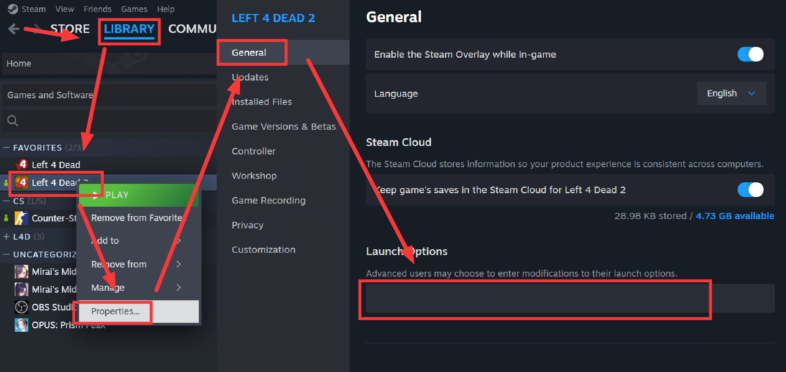

    * Common Launch Options Parameters:
        * `-lv` - Low Violence mode. Disables blood splatter, ragdolls, and dismemberment to improve game performance.
        * `-novid` or `-novideo` - Skips the intro video when launching the game.
        * `-w xxx` - Sets the game screen resolution width, where `xxx` is a number.
        * `-h xxx` - Sets the game screen resolution height, where `xxx` is a number.
        * `-fullscreen` - Forces the game to launch in fullscreen mode.
        * `-windowed` or `-sw` - Forces the engine to launch in windowed mode.
        * `-dev` - Enables Developer Mode, typically used by developers for debugging.
        * For more parameters, visit official support: [Steam Support: Setting Game Launch Options](https://help.steampowered.com/en/faqs/view/7d01-d2dd-d75e-2955)
</details>

- - - -
## Verifying Integrity of Game Files
* Why and when should you verify game files?
    * Game files are corrupted due to installing too many custom mods.
    * You suspect game files are corrupted and need repair.
    * Game files have been modified and you wish to restore original settings.
    * The game experiences crashes or issues more frequently than usual.

* <details><summary>How to verify?</summary>

    * Follow the steps in the image. The Steam platform will automatically scan all game files and restore any modified/missing files to match official defaults.
    <br/>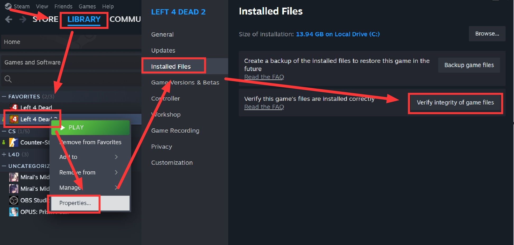
</details>

- - - -
## Enabling the Game Instructor System
* <details><summary>What is the Game Instructor System?</summary>

    * It displays in-game hints such as reminding you to use medkits, pick up weapons, or trigger objective mechanisms.
    <br/>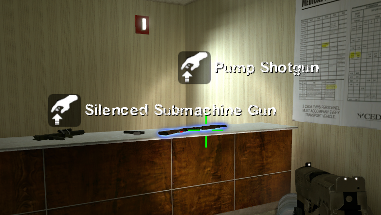
    <br/>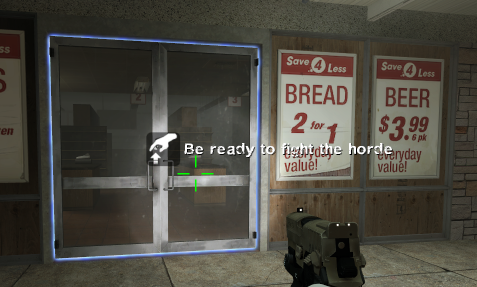
</details>

* <details><summary>How to enable?</summary>

    * Method 1: Open the console and enter `gameinstructor_enable 1` (`0` turns it off).
        ```php     
        ] gameinstructor_enable 1
        ```
    * Method 2: ESC -> Options -> Multiplayer -> Game Instructor -> Enabled.
    <br/>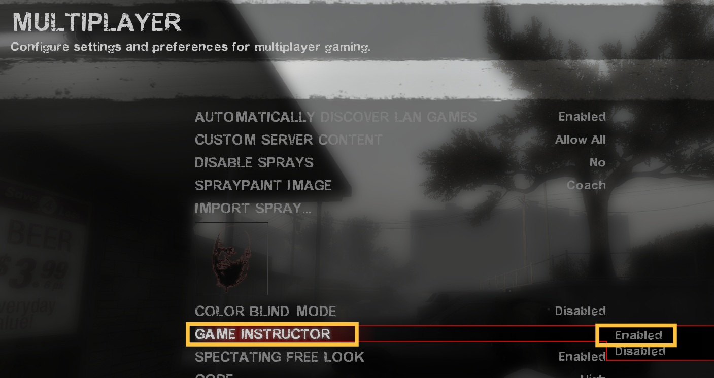
</details>

* <details><summary>When should it be enabled?</summary>

    * Playing custom/third-party campaign maps, when you need hints on how to navigate the map or activate objective triggers (most custom maps rely on these hints).
        * For example: [Resident Evil](https://steamcommunity.com/sharedfiles/filedetails/?id=533677587), [Questionable Ethics](https://steamcommunity.com/sharedfiles/filedetails/?id=2783476025&searchtext=question), etc.
    * When plugins utilize or modify the Game Instructor system.
        * For example: [l4d2_item_hint](https://github.com/fbef0102/L4D1_2-Plugins/tree/master/l4d2_item_hint), etc.
        <br/>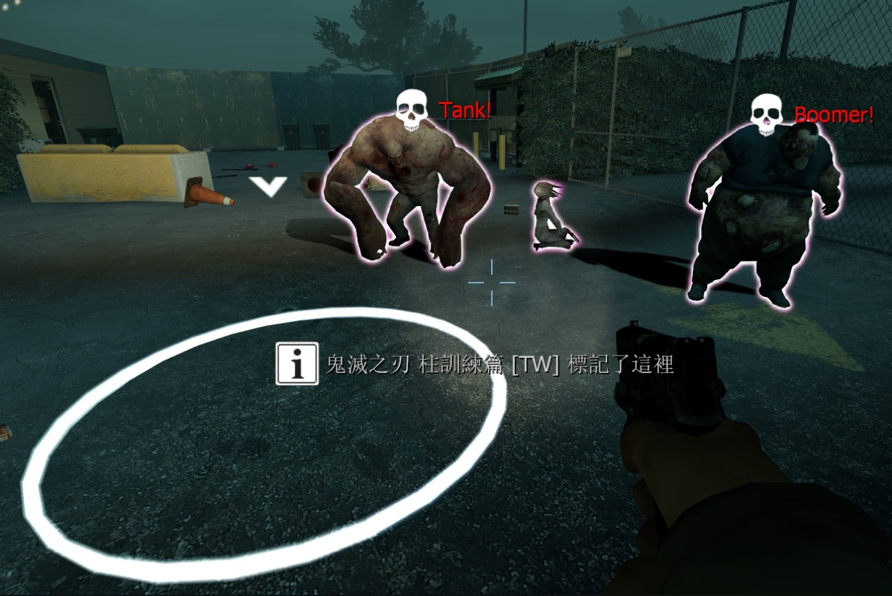
    * When you are a beginner player.
</details>

* <details><summary>Q1: Why are hints still not showing up after enabling it?</summary>

  * Reason 1: The Game Instructor system is controlled dynamically by the AI Director based on current survivor conditions to prevent cluttering the player's HUD with too many messages.
  * Reason 2: The server administrator has forced `sv_gameinstructor_disable 1`, disabling the Game Instructor system for all connected players.
  * Reason 3: You are playing Realism mode. Realism mode disables most UI hints, keeping only essential objective mechanism prompts.
</details>

- - - -
## Downloading Custom Server Content
* <details><summary>What is Custom Server Content?</summary>

    * Games allow community players to host dedicated servers with customized gameplay. Some servers host custom models or assets available for players to download upon joining:
        * [Play custom music](https://github.com/fbef0102/L4D1_2-Plugins/tree/master/l4d_MusicMapStart): All players can hear custom audio files.
        <br/>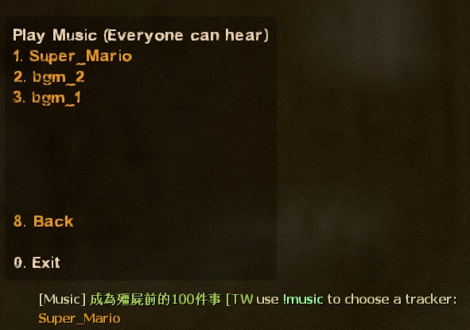
        * [Custom map decals](https://github.com/fbef0102/Sourcemod-Plugins/tree/main/map-decals): All players can view custom textures/decals.
        <br/>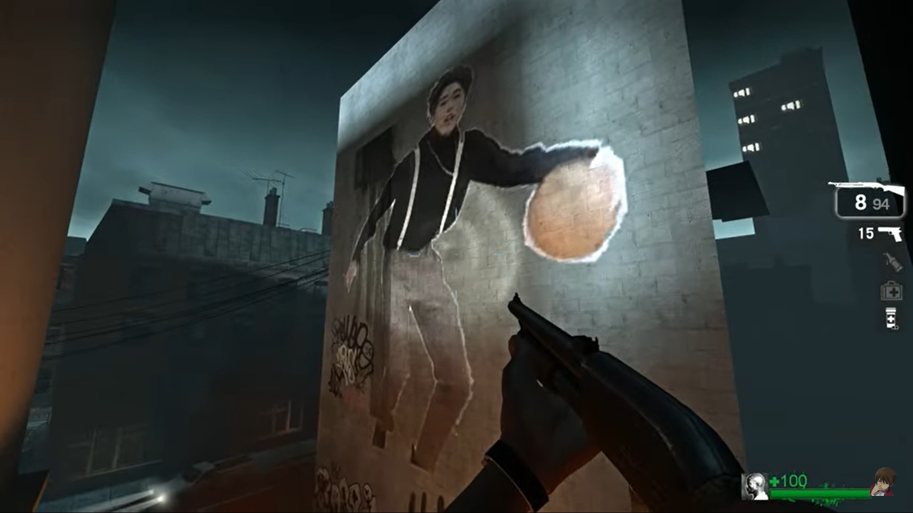
        * [Custom character models](https://forums.alliedmods.net/showthread.php?t=284157): All players can view custom character skins.
        <br/>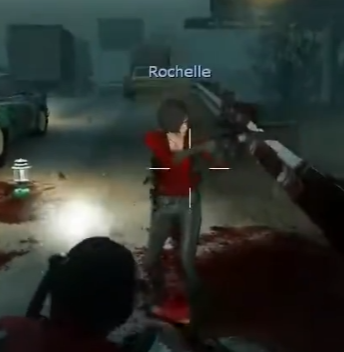
        * [Dance animations/Emotes](/L4D_%E6%8F%92%E4%BB%B6/Fun_%E5%A8%9B%E6%A8%82/fortnite_dances_emotes_l4d): All players can view custom dance animations.
        <br/>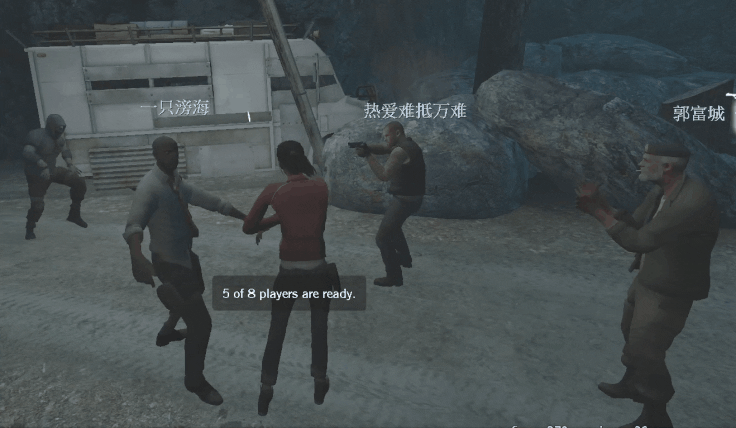
</details>

* <details><summary>How to enable?</summary>
   
    * ESC -> Options -> Multiplayer -> Custom Server Content -> Allow All.
    <br/>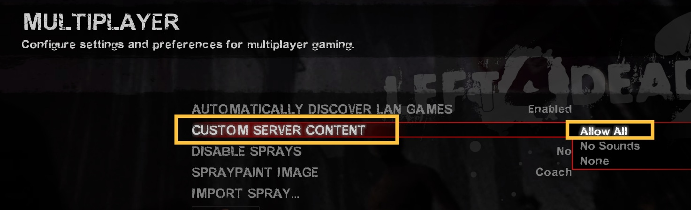
    * Once enabled, assets will automatically download during server connection. If successful, you will see download logs in the developer console.
    <br/>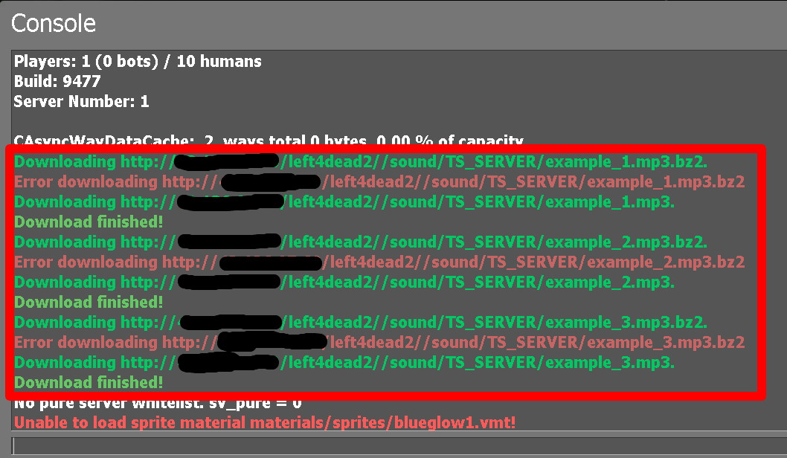
    * Note: L4D1 and certain games do not display these console logs. You must check your game folder directly to verify downloaded files.
</details>

* <details><summary>Q1: Can I disable this feature?</summary>

    * Yes, you can disable it. Upon entering community servers, custom assets will no longer auto-download, meaning you will not hear custom audio or see custom player models.
    * Some players prefer disabling this to avoid unwanted downloads or modified server content.
</details>