# Problem Overview
> Updated 2025/8/25
- [Problem Overview](#problem-overview)
  - [Introduction](#introduction)
  - [Choosing Between Listen Server or Dedicated Server](#choosing-between-listen-server-or-dedicated-server)
  - [How to Install a Dedicated Server](#how-to-install-a-dedicated-server)
  - [How to Install SourceMod](#how-to-install-sourcemod)
  - [How to Run a Dedicated Server](#how-to-run-a-dedicated-server)
  - [How to Check Versions](#how-to-check-versions)
  - [How to Join My Server](#how-to-join-my-server)
  - [Setting Up Router / Wireless AP / Firewall / Modem](#setting-up-router--wireless-ap--firewall--modem)
  - [How to Matchmake into a Dedicated Server from Lobby](#how-to-matchmake-into-a-dedicated-server-from-lobby)
  - [How to Become a Server Admin](#how-to-become-a-server-admin)
  - [How to Compile Source Code](#how-to-compile-source-code)
  - [How to Install Plugins](#how-to-install-plugins)
  - [How to check if a plugin is working properly](#how-to-check-if-a-plugin-is-working-properly)
  - [How to Remove Plugins](#how-to-remove-plugins)
  - [How to Update Plugins](#how-to-update-plugins)
  - [How to Manually Manage Plugins](#how-to-manually-manage-plugins)
  - [How to Check ConVar Values](#how-to-check-convar-values)
  - [How to Modify ConVars](#how-to-modify-convars)
  - [How to Use Plugin Commands](#how-to-use-plugin-commands)
  - [How to Update a Dedicated Server](#how-to-update-a-dedicated-server)
  - [How to Update SourceMod](#how-to-update-sourcemod)
  - [Terminology Introduction](#terminology-introduction)
  - [Other Resources](#other-resources)
> __Note__ This tutorial covers SourceMod exclusively and has no relation to AMX Mod X.

- - - -
## Introduction
- Valve games such as Left 4 Dead, Counter-Strike: Source, No More Room in Hell, and Team Fortress 2 allow community players to host their own servers.
- Community players can install plugins on their servers to freely modify game content and gameplay, creating rich and diverse game modes.
   * Examples include CS Zombies, Battle Royale, Team Deathmatch, and L4D 8v8 Versus or Multi-player Campaign—all built by players using custom servers and plugins.
   * With hundreds of plugins available, players can craft a unique server style. However, to run plugins successfully, you must first install SourceMod.
- This guide provides step-by-step instructions on hosting your own dedicated server on a PC and installing SourceMod.

- - - -
## Choosing Between Listen Server or Dedicated Server
- Servers fall into two categories: Listen and Dedicated.
   * Launching the game client and creating a room produces a **Listen Server** (commonly known as a local host/room).
   * Launching a server via third-party tools/scripts produces a **Dedicated Server**.
- If you wish to set up a Listen Server, see [this article](/Tutorial_教學區/English/Server/Install_Local_Server_Plugin/README.md#what-is-a-listen-server).
- You can choose to install SourceMod on either a Dedicated Server or a Listen Server.
	- **Dedicated Server is highly recommended** because all plugins support Dedicated Servers, whereas SourceMod support for Listen Servers is very limited.
	- Most plugin developers will not troubleshoot issues occurring on Listen Servers.
	- 🟥 **Linux OS does not support running SourceMod on a Listen Server.**

- - - -
## How to Install a Dedicated Server
* <details><summary>Windows Installation Steps (Click to expand)</summary>

   1. Download [SteamCMD](https://steamcdn-a.akamaihd.net/client/installer/steamcmd.zip).

   2. Extract it to any directory on your computer. It is recommended to create a dedicated folder without non-ASCII characters in the path.
      - E.g., `D:\steamcmd`
      <br/>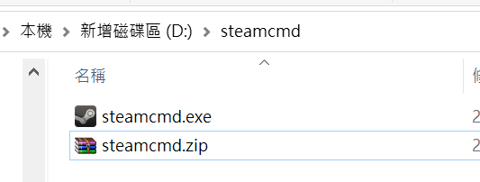

   3. Run `steamcmd.exe` and wait for it to download packages and updates automatically.
      <br/>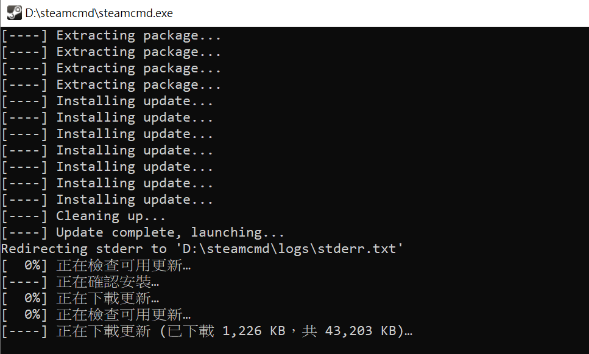

   4. Once `Loading Steam API...OK` appears, enter the following commands sequentially:
      <br/>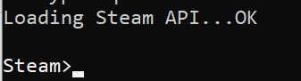
      - `force_install_dir ./L4D2_Server/`
         - `L4D2_Server` is the destination folder name (customizable, avoid non-ASCII characters). All server files will be installed here.
      - `login "xxxxx" "yyyyy"`
         - `xxxxx` is your Steam account username (not display name or Steam ID).
         - `yyyyy` is your Steam account password.
         - 🟥 Remember the space and quotation marks `"`.
         - 🟥 Per updated Steam policies, anonymous login for server installation is no longer supported for most games.
         - First-time login requires 2FA authentication; enter your Steam Guard code.
      - `app_update XXXXXX validate`
         - `XXXXXX` is the game server's App ID. Search [steamdb](https://steamdb.info/) for game IDs:
            - `222840`: L4D - Dedicated Server
            - `222860`: L4D2 - Dedicated Server
            - `232330`: Counter-Strike: Source - Dedicated Server
            - `317670`: No More Room in Hell - Dedicated Server
         
      <br/>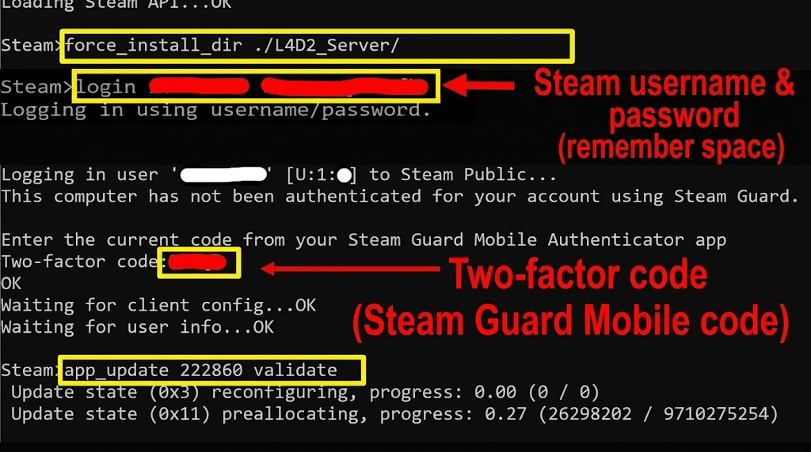

   5. Once complete, type `exit` to close SteamCMD.
      <br/>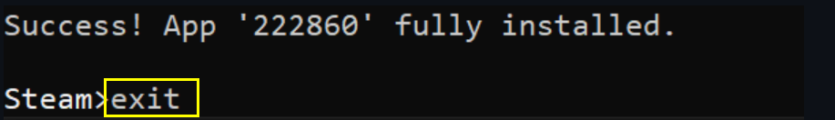

   6. Check the installation directory to verify server files.
      <br/>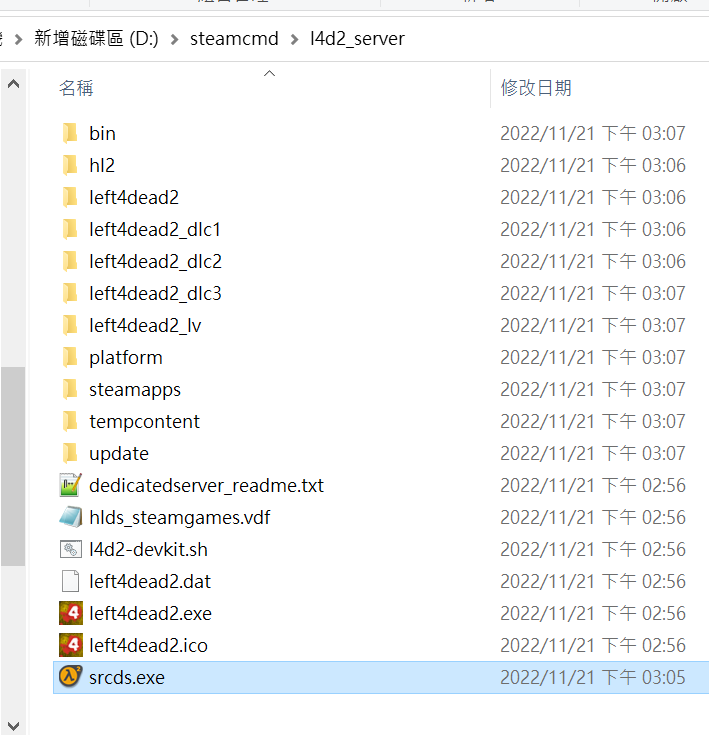
</details>

* <details><summary>Linux Installation Steps (Click to expand)</summary>

   1. Open a terminal and run the following commands (root privileges may be required):
      - `cd /your/desired/path` (create a dedicated directory without non-ASCII characters)
      - `wget http://media.steampowered.com/installer/steamcmd_linux.tar.gz`
      - `tar -xvzf steamcmd_linux.tar.gz`
      - `./steamcmd.sh`
      <br/>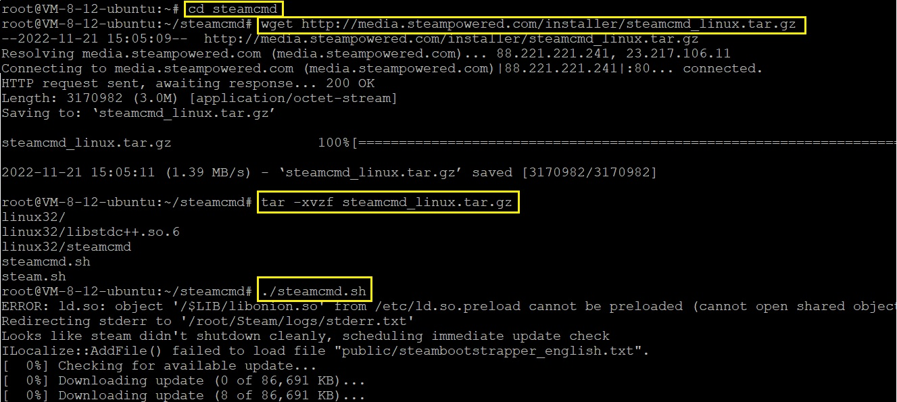

   2. Once `Loading Steam API...OK` appears, enter the following commands sequentially:
      <br/>
      - `force_install_dir ./L4D2_Server/`
         - `L4D2_Server` is the destination folder name (customizable, avoid non-ASCII characters).
      - `login "xxxxx" "yyyyy"`
         - `xxxxx` is your Steam account username.
         - `yyyyy` is your Steam account password.
         - 🟥 Remember the space and quotation marks `"`.
         - 🟥 Anonymous logins are restricted.
         - Authenticate via Steam Guard if prompted.
      - `app_update XXXXXX validate`
         - `XXXXXX` is the game server App ID:
            - `222840`: L4D - Dedicated Server
            - `222860`: L4D2 - Dedicated Server
            - `232330`: Counter-Strike: Source - Dedicated Server
            - `317670`: No More Room in Hell - Dedicated Server

      <br/>

   3. Once complete, type `exit` to close SteamCMD.
      <br/>

   4. Check the installation directory to verify server files.
      <br/>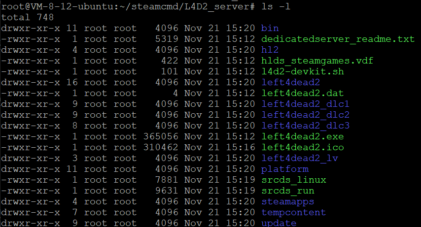

   5. **Linux requires installing required dependency libraries before proceeding.**
      * [Click here to view installation commands for various Linux distributions](https://github.com/fbef0102/Sourcemod-Server?tab=readme-ov-file#dependencies)
</details>

- - - -
## How to Install SourceMod
* <details><summary>Installation Steps (Click to expand)</summary>

   1. Download the latest release from [SourceMod Stable Downloads](https://www.sourcemod.net/downloads.php?branch=stable).
      - Choose the Windows icon for Windows OS, or the Penguin icon for Linux OS.
      - Red icons indicate the build is not yet supported for that platform.
      - [Do not download Dev builds unless necessary](/Questions_問題區/English/Server/README.md#why-are-there-two-types-of-sourcemod-downloads).
      <br/>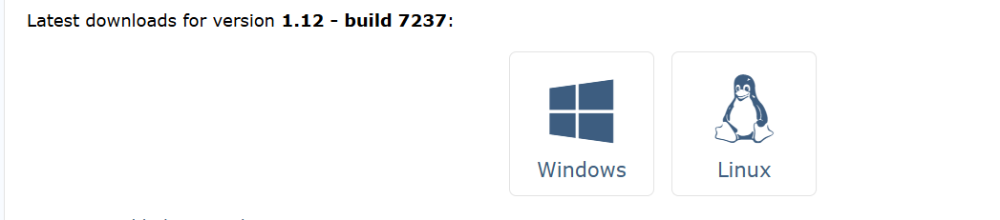

   2. Download the latest release from [MetaMod Stable Downloads](https://www.sourcemm.net/downloads.php?branch=stable).
      - Select Windows or Linux package accordingly.
      <br/>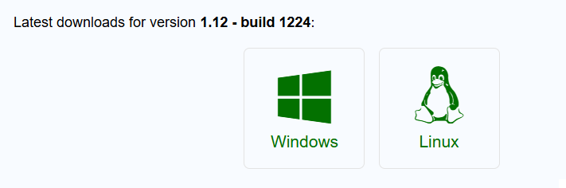
   
   3. Extract all files into your server root path (`left4dead2` or equivalent game directory). The directory structure should look like the images below (pay attention to paths):
      <br/>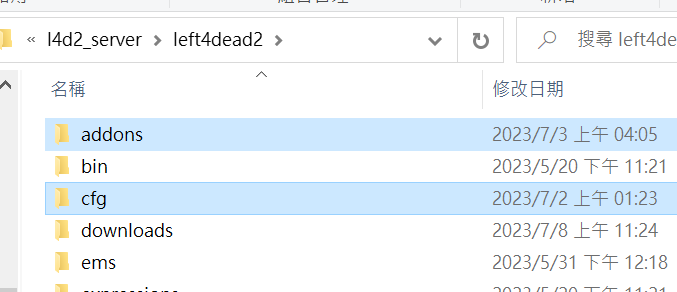
      <br/>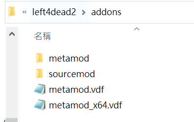

   4. Go to [sourcemm.net vdf generator](https://www.sourcemm.net/vdf), select your game, click "Generate metamod.vdf", and download/place `metamod.vdf` into the `addons/` directory, overwriting any existing file.
      <br/>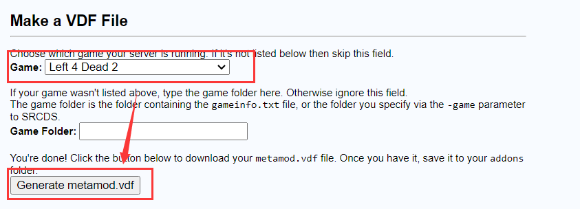
      <br/>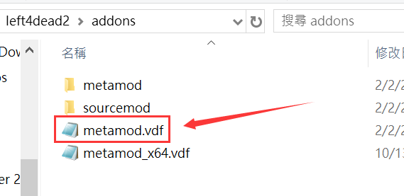
</details>

- - - -
## How to Run a Dedicated Server
* <details><summary>Windows (Click to expand)</summary>

   1. In your server root directory (where `srcds.exe` resides), create a batch file named `srcds.bat`. Open it with Notepad and paste the following content:
      ```bat
      start srcds.exe -console -game xxxxxx -port 27016 +log on +exec server.cfg +sv_lan 0 -maxplayers 31 +map c1m1_hotel
      ```
      <br/>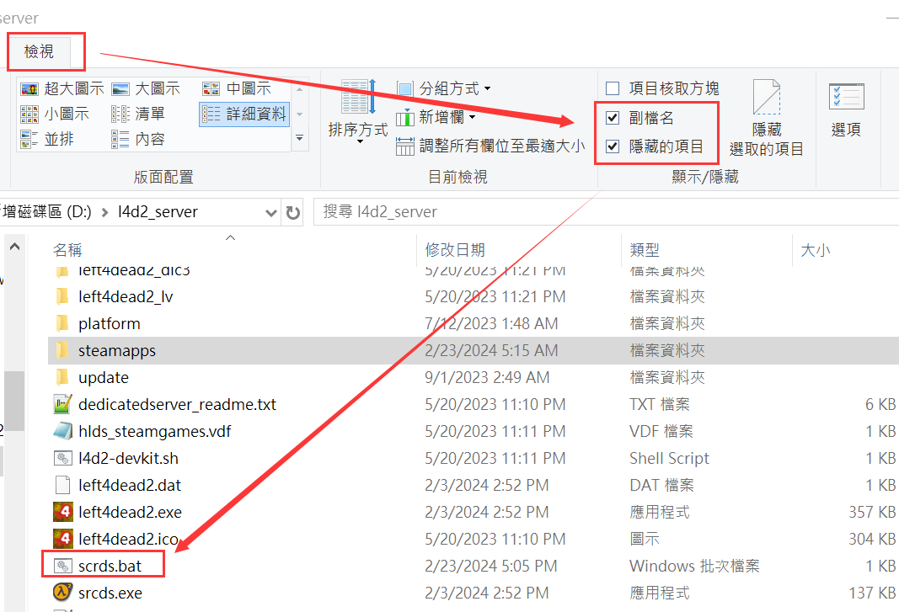
      <br/>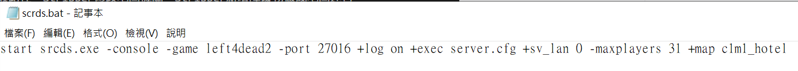
      - These are launch options/parameters. Add any future command line flags here.
      - Replace `xxxxxx` with the game directory name:
         - For L4D1: `left4dead`
         - For L4D2: `left4dead2`
         - For CS:S: `cstrike`
         - For NMRiH: `nmrih`
      - `-port 27016`: Defines the UDP server port.
         - 🟥 Do not alter UDP ports arbitrarily; safe range is typically `27016` ~ `27035`.
      - `+log on`: Enables server logging.
      - `+exec server.cfg`: Executes `cfg/server.cfg` upon server startup.
         * 🟥 If `server.cfg` does not exist, create it manually. Customize its contents according to game requirements.
         * Example: [My server.cfg template](https://github.com/fbef0102/Sourcemod-Server/blob/main/L4D2/Windows%20Server%20Files/left4dead2/cfg/server.cfg)
      - `+sv_lan 0`: Sets server to Internet mode.
      - `-maxplayers 31`: Sets maximum client capacity limit. Actual playable slots remain subject to game mode constraints (e.g., L4D Campaign max 4 players, Versus max 8 players).
      - Optional parameters:
         - `+map c2m2_fairgrounds`: Sets the startup map.
         - `+sv_password 12345`: Sets server join password to `12345` (avoid non-ASCII characters).

   2. Double-click `srcds.bat` to launch the server. A command prompt window will open—this is your server console (backend).
   <br/>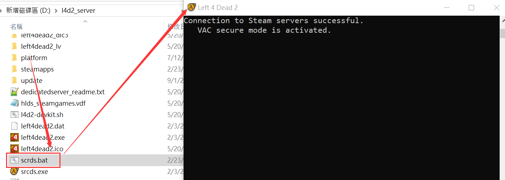

   3. (Windows) On first run, if Windows Firewall prompts a security alert, check both private/public boxes and click "Allow access".
   <br/>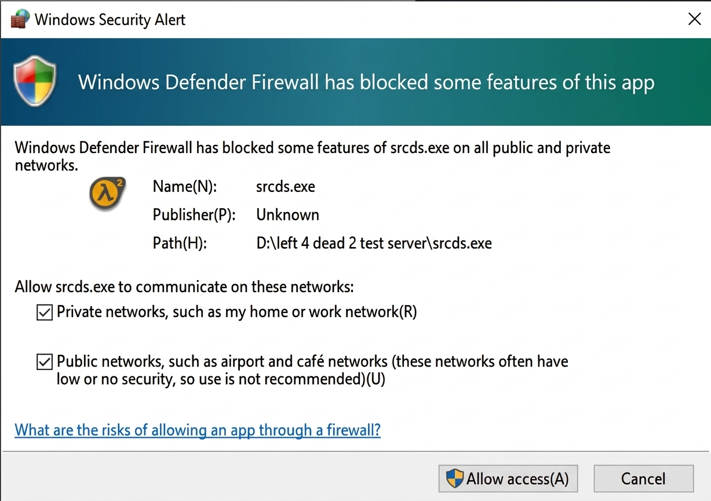

   4. To verify SourceMod is functioning, type `sm version` in the server console. If it does not output version information as shown, review previous steps.
      <br/>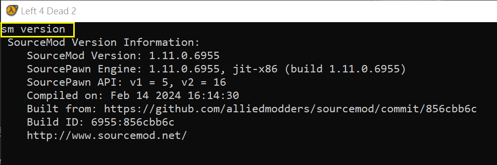
</details>

* <details><summary>Linux (Click to expand)</summary>

   1. Open terminal, navigate to the server directory, and execute:
      ```bash
      ./srcds_run -console -game xxxxxx -port 27016 +log on +exec server.cfg +sv_lan 0 -maxplayers 31
      ```
      - `xxxxxx`: Game directory name (`left4dead`, `left4dead2`, `cstrike`, `nmrih`).
      - `-port 27016`: Server UDP port.
      - `+log on`: Enables server logging.
      - `+exec server.cfg`: Executes configuration file on startup.
         - [My Linux server.cfg template](https://github.com/fbef0102/Sourcemod-Server/blob/main/L4D2/Linux%20Server%20Files/left4dead2/cfg/server.cfg)
      - `+sv_lan 0`: Sets Internet visibility.
      - `-maxplayers 31`: Maximum player slots.
   2. Verify SourceMod status by running `sm version` in the terminal output interface.
      <br/>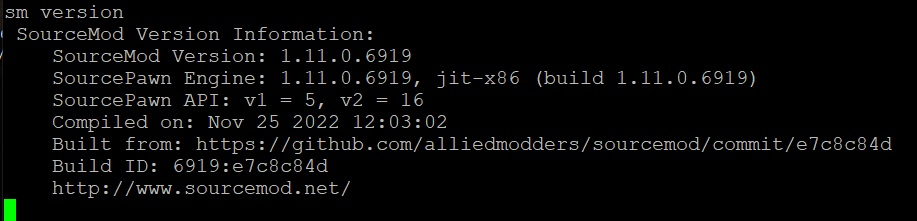
</details>

- - - -
## How to Check Versions
* <details><summary>Locating the Server Console (Click to expand)</summary>

   * When running via `.bat`, the opened window is your server console.
   <br/>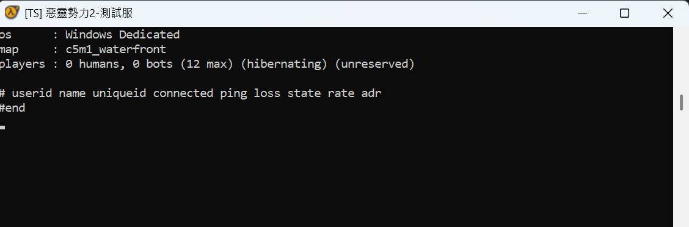
   * If running `srcds.exe` GUI directly, locate the Console tab.
   <br/>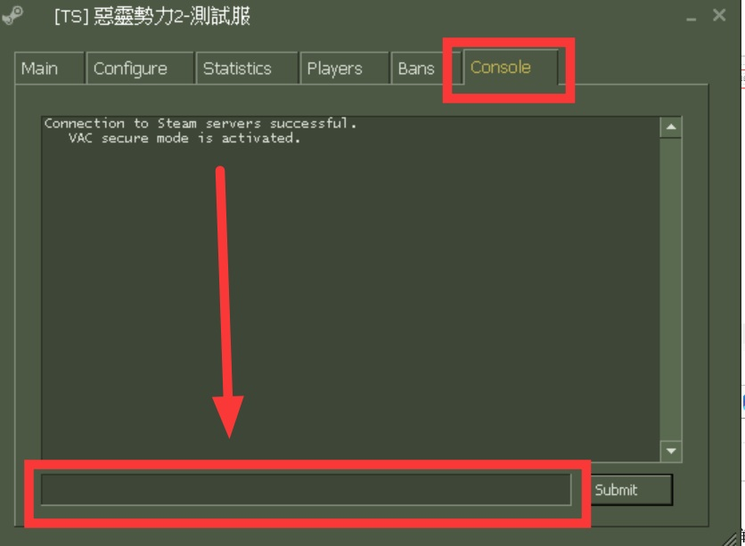
</details>

* <details><summary>Checking Game Platform Version (Click to expand)</summary>
  
   * In server console, type `version`:
      ```php
      ] version
      Version 2.2.2.5 (left4dead2)
      Network Version 2.1.0.0
      Exe build: 16:48:59 Feb  4 2022 (8490) (550)
      ```
</details>

* <details><summary>Checking SourceMod Version (Click to expand)</summary>

   * In server console, type `sm version`:
      ```php
      ] sm version
         SourceMod Version Information:
            SourceMod Version: 1.11.0.6905
            SourcePawn Engine: 1.11.0.6905, jit-x86 (build 1.11.0.6905)
            SourcePawn API: v1 = 5, v2 = 16
            Compiled on: Jul  3 2022 01:15:17
            Built from: https://github.com/alliedmodders/sourcemod/commit/5e3a1896
            Build ID: 6905:5e3a1896
            http://www.sourcemod.net/
      ```
</details>

* <details><summary>Checking MetaMod Version (Click to expand)</summary>

   * In server console, type `meta version`:
      ```php
      ] meta version
         Metamod:Source Version Information
            Metamod:Source version 1.11.0-dev+1148
            Plugin interface version: 16:14
            SourceHook version: 5:5
            Loaded As: Valve Server Plugin
            Compiled on: Jun 24 2022 14:34:21
            Built from: https://github.com/alliedmodders/metamod-source/commit/4bdc218
            Build ID: 1148:4bdc218
            http://www.metamodsource.net/
      ```
</details>

* <details><summary>Checking Installed Extensions (Click to expand)</summary>

   * In server console, type `sm exts list`:
      ```php
         ] sm exts list
         [SM] Displaying 11 extensions:
         [01] Automatic Updater (1.11.0.6905): Updates SourceMod gamedata files
         [02] Webternet (1.11.0.6905): Extension for interacting with URLs
         [03] Top Menus (1.11.0.6905): Creates sorted nested menus
         [04] SDK Tools (1.11.0.6905): Source SDK Tools
         [05] BinTools (1.11.0.6905): Low-level C/C++ Calling API
         [06] SDK Hooks (1.11.0.6905): Source SDK Hooks
         [07] Client Preferences (1.11.0.6905): Saves client preference settings
         [08] SQLite (1.11.0.6905): SQLite Driver
         [09] DHooks (1.11.0.6905): Dynamic Hooks
         [10] Regex (1.11.0.6905): Provides regex natives for plugins
         [11] GeoIP (1.11.0.6905): Geographical IP information
      ```
</details>

* <details><summary>Checking MetaMod Plugins (Click to expand)</summary>
  
   * In server console, type `meta list`:
      ```php
         ] meta list
         Listing 11 plugins:
            [01] SourceMod (1.11.0.6905) by AlliedModders LLC
            [02] SDK Tools (1.11.0.6905) by AlliedModders LLC
            [03] SDK Hooks (1.11.0.6905) by AlliedModders LLC
            [04] DHooks (1.11.0.6905) by AlliedModders LLC
      ```
</details>

* <details><summary>Checking Loaded SourceMod Plugins (Click to expand)</summary>
  
   * In server console, type `sm plugins list`:
   ```php
      ] sm plugins list
      [SM] Listing 11 plugins:
         001 "Admin File Reader" (1.11.0.6905) by AlliedModders LLC
         002 "Admin Help" (1.11.0.6905) by AlliedModders LLC
         003 "Admin Menu" (1.11.0.6905) by AlliedModders LLC
         004 "Anti-Flood" (1.11.0.6905) by AlliedModders LLC
         005 "Basic Ban Commands" (1.11.0.6905) by AlliedModders LLC
         006 "Basic Chat" (1.11.0.6905) by AlliedModders LLC
         007 "Basic Comm Control" (1.11.0.6905) by AlliedModders LLC
         008 "Basic Commands" (1.10.0.6502) by AlliedModders LLC
         009 "Basic Info Triggers" (1.11.0.6905) by AlliedModders LLC
         010 "Basic Votes" (1.11.0.6905) by AlliedModders LLC
         011 "Client Preferences" (1.11.0.6905) by AlliedModders LLC
   ```
</details>

* <details><summary>Checking Engine Plugins (Click to expand)</summary>

   * In server console, type `plugin_print`:
      ```php
         ] plugin_print
         Loaded plugins:
         ---------------------
         0:      "Metamod:Source 1.11.0-dev+1148"
         ---------------------
      ```
</details>

- - - -
## How to Join My Server
* <details><summary>Instructions (Click to expand)</summary>

   1. Find your server IP address. In server console, type `status`:
      <br/>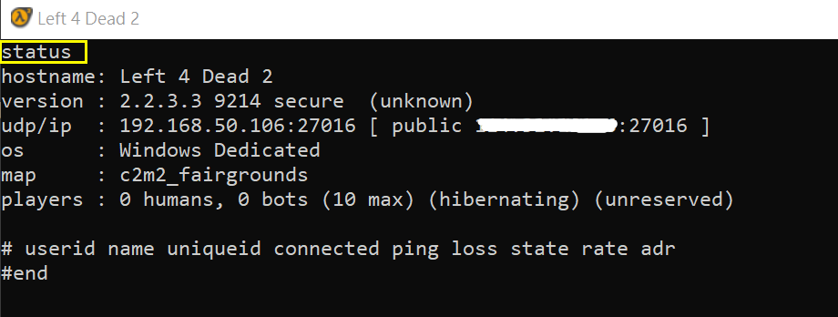
      - `hostname`: Server display name
      - `version`: Server build version
      - `udp/ip`: Server IP address
         - First address (`192.168.50.106:27016`) is the **LAN / Private IP**, accessible only within the local network.
         - Second address (redacted) is the **Public / External IP**, accessible globally.
         - 🟥 `27016` represents the network port bound to this server process.
      - `os`: Host operating system
      - `map`: Current active map
      - `players`: Active player status list

   > [!WARNING]
   > Do not share your public IP address unnecessarily to protect against network attacks.
      
   2. Launch the game -> Open developer console -> Type `connect x.x.x.x:yyyyy`:
      <br/>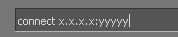
      - `x.x.x.x:yyyyy` is your server's Public IP and Port.
      - Have an external friend test connecting. If connection fails, router settings (NAT/Port Forwarding) or local Windows Firewall are likely blocking incoming traffic.
         1. Request a Static IP from your ISP if needed, then set up Port Forwarding on your router (Virtual Server / NAT Rules).
            * Forward port `27016` (UDP).
            * Consult your router manufacturer guide for exact UI instructions.

         2. Check Windows Firewall:
            * Ensure `srcds.exe` is allowed through Firewall.
            * Ensure UDP inbound rule for port `27016` is enabled.
      - 🟥 If external players cannot connect, resolve network forwarding before proceeding further.
      - [Troubleshooting connection issues](/Questions_問題區/English/Server/README.md#why-cant-i-join-the-server)

   3. Once connected, open game console and run `status` to confirm connection to the intended address.
   <br/>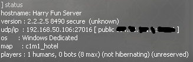

   4. At this point, basic server setup is complete.
</details>

- - - -
## Setting Up Router / Wireless AP / Firewall / Modem
> [!CAUTION]
> 🟥 The following network environments currently **cannot** host servers accessible to public internet users:
> * Mobile Broadband (3G/4G/5G/6G Tethering / Hotspots)
> * Public / Shared Wi-Fi Networks
> * Campus, Corporate, or Dorm Networks with restricted admin control
> * Any router/modem configuration where administrative access is unavailable

* <details><summary>Example Setup (Click to expand)</summary>
   
   0. Connect your server host machine via Ethernet cable directly to your router/modem (avoid Wi-Fi).
      * 🟥 Turn off Game Accelerators, VPNs, or proxy software that alter IP routes.
      * In server console, type `status` and record IP addresses.
      <br/>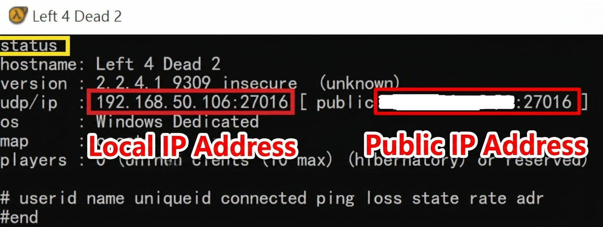
      * Note your router/modem model number.
      <br/>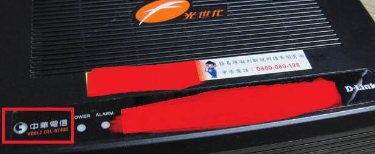
         ```c
         OS: Windows 10
         ISP: Chunghwa Telecom
         Public IP: (Obtained via status command)
         Router Model: DSL-6740C
         Server LAN IP: 192.168.50.106
         Server Port: 27016 (UDP)
         ```

   1. Open a web browser, enter `http://192.168.1.1/` (or default gateway), and log in to router management interface.
      * Default credentials vary by brand/ISP; look up model documentation.
      * Cloud VPS providers (e.g., Tencent Cloud, AWS) handle this via Security Group / Firewall rules in their control portal.
      <br/>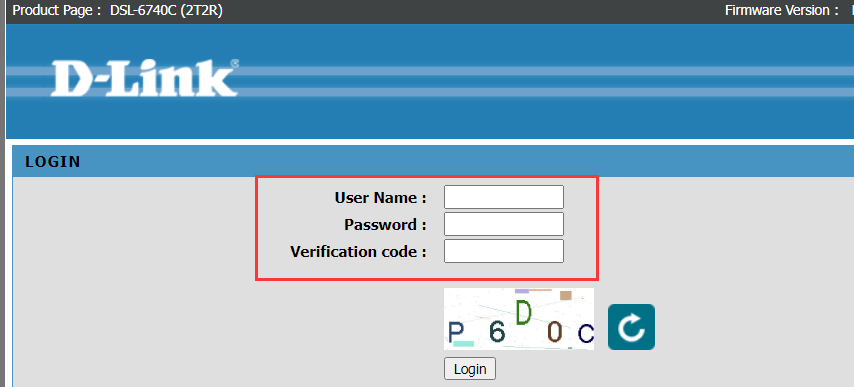

   2. Check internet connection interface/mode.
      <br/>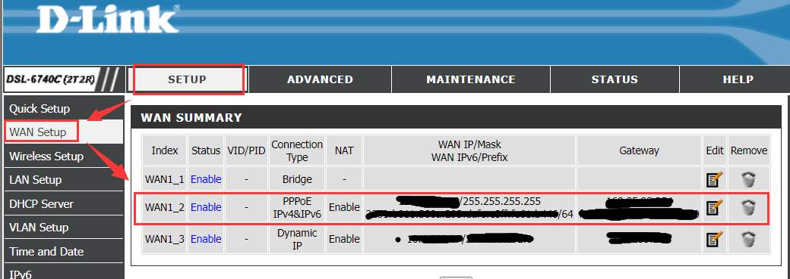
      ```c
      Connection Type: PPPoE IPv4&IPv6
      Interface: WAN1_2
      ```

   3. Set up Port Forwarding (Virtual Server / Port Mapping / NAT Forwarding).
   <br/>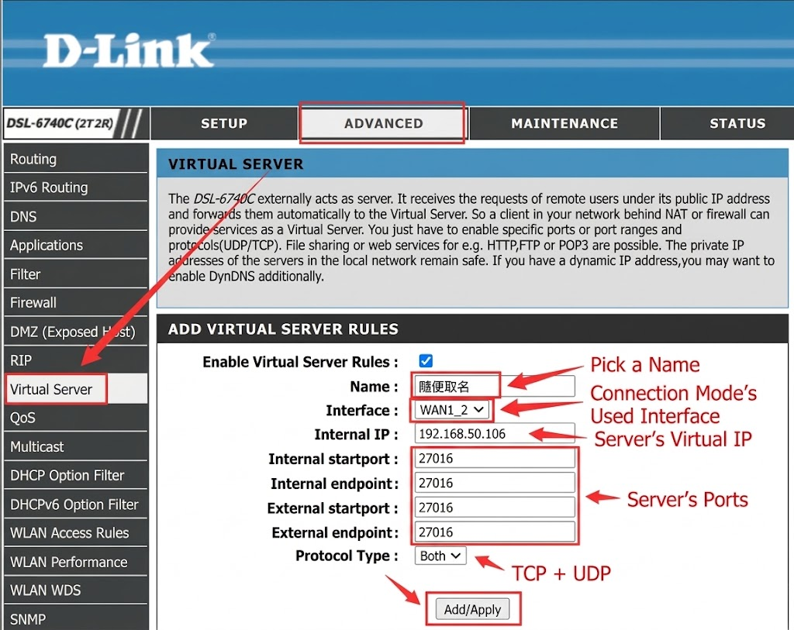

   4. Reboot router through the web management interface.
      <br/>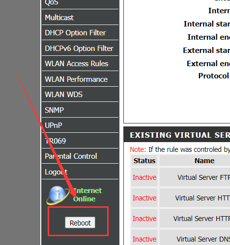
   
   5. Configure host Windows Firewall: create 2 Inbound Rules and 2 Outbound Rules allowing UDP/TCP for port `27016`.
      <br/>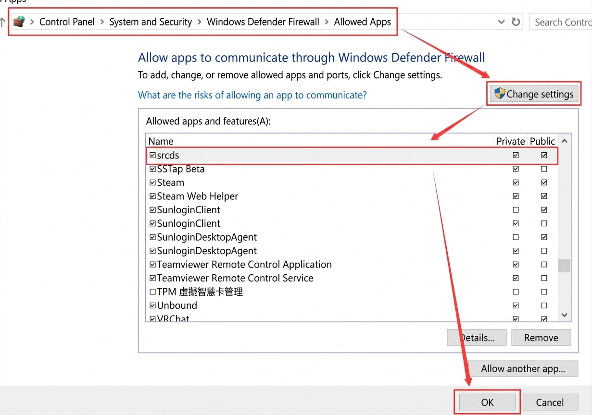
      <br/>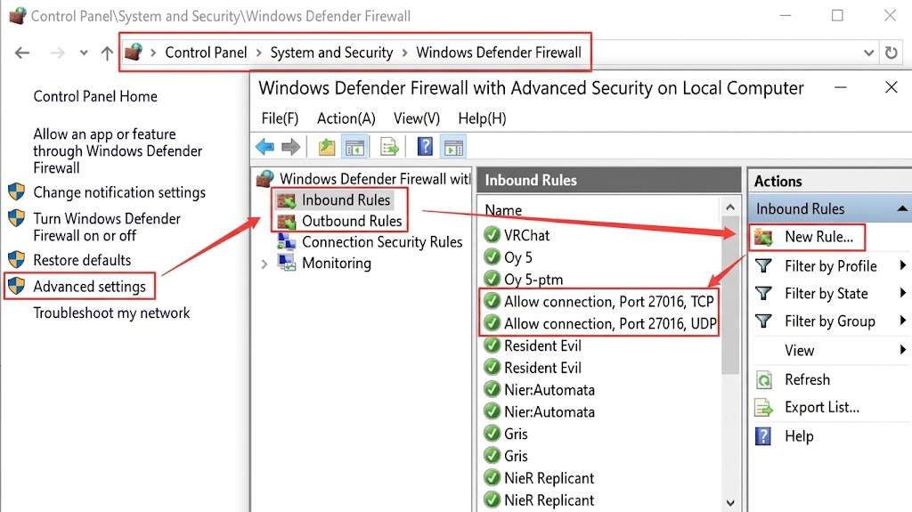
   
   6. Restart host PC, launch server, and have external players join via `connect x.x.x.x:yyyyy` (Public IP).

   7. Verify via game console `status` after joining.
      <br/>

   8. If IP matches public address and external connection works, port forwarding is successfully set up.
</details>

- - - -
## How to Matchmake into a Dedicated Server from Lobby
* <details><summary>Instructions (Click to expand)</summary>

   1. Obtain your server's **Public IP address** via console command `status`.
      <br/>

   2. In `cfg/server.cfg`, add the following line (create file if missing):
      ```php
      sv_allow_lobby_connect_only 1
      ```

   3. Launch game -> Create Lobby -> Set Server Type to **"Best Available Dedicated"** -> Open developer console -> Type:
      ```php
      mm_dedicated_force_servers x.x.x.x:yyyyy
      ```
      <br/>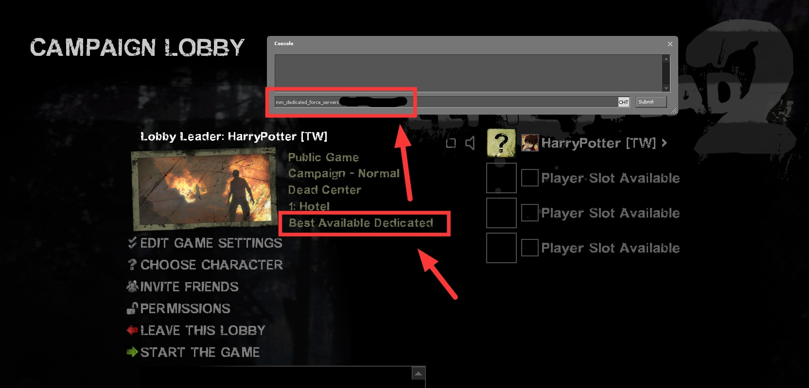
      - `x.x.x.x:yyyyy` must be the server's Public IP.
      - Do not enter LAN IP, or only local host can connect.

   4. Invite players or start match.

   5. After joining, run `status` in game console to verify server instance.
      <br/>

   > __Warning__ 
   > * Lobby matchmaking forces connection only when the target server has 0 active players.
   > * If players are already on the server, join directly via `connect x.x.x.x:yyyyy`.
</details>

- - - -
## How to Become a Server Admin
* <details><summary>Instructions (Click to expand)</summary>

   1. Locate your Steam ID. In Steam client, go to Profile -> Right-click and choose "Copy Page URL".
      <br/>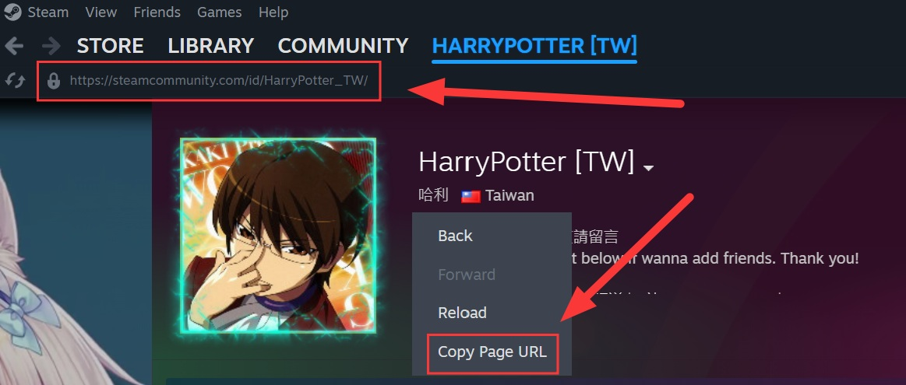

   2. Visit [Steam ID Finder](https://steamid.xyz/), paste your URL, and submit to retrieve your Steam ID (`STEAM_X:X:XXXXXX`).
      <br/>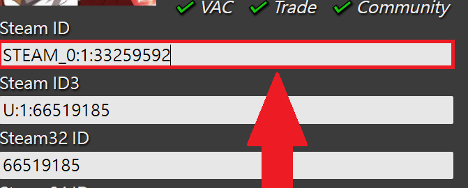

   3. Open `addons/sourcemod/configs/admins_simple.ini` with Notepad. Add a line at the bottom:
      ```php
      "STEAM_X:X:XXXXXX" "99:z" // Server Admin
      ```
      
   4. Save file and restart server (or run `sm_reloadadmins`). In-game chat, type `!admin`. If admin menu pops up on the left, permissions are configured correctly.
      <br/>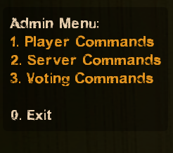
</details>

- - - -
## How to Compile Source Code
* <details><summary>Compilation Workflow (Click to expand)</summary>

   1. Place `.sp` source files into `addons/sourcemod/scripting/`.
      - Avoid non-ASCII file names, english name only.
      - Ensure file extensions are visible in OS settings.
      <br/>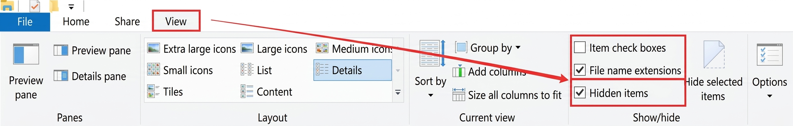

   2. Drag and drop the `.sp` file onto `compile.exe` within the same folder.
      <br/>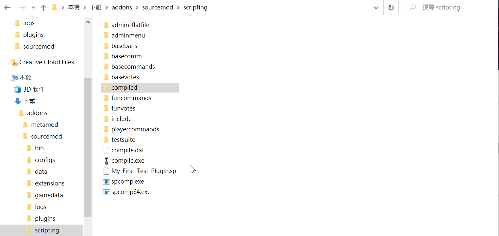

   3. Compiled plugin (`.smx`) will be generated in `addons/sourcemod/scripting/compiled/` folder.
      - If compilation fails with error outputs, check for missing `.inc` files or syntax errors.
         * [Common compilation error messages](/Questions_問題區/English/Plugin/README.md#common-compilation-error-messages)
      - Plugins compiled under Windows are cross-platform compatible across Windows, Linux, and macOS.
</details>

- - - -
## How to Install Plugins
* <details><summary>Installation Steps (Click to expand)</summary>

   1. Place compiled `.smx` plugin files into `addons/sourcemod/plugins/`.
      - Do not use non-ASCII characters in plugin filenames.

   2. Install supplementary assets according to directory structure:
      - Translation files (`.phrases.txt`) go into `addons/sourcemod/translations/`.
         <details><summary>Translation File Example (Click to expand)</summary>

         Filename: `xxxx.phrases.txt`
         ```
         "Phrases"
         {
            "You're spectating. Join any team to play."
            {
               "en"	"You're spectating. Join any team to play."
               "zho"	"輸入 !join 加入遊戲..."
               "chi"	"输入 !join 加入游戏..."
            }	
            "[AFK] Inactivity detected! 1"
            {
               "#format"		"{1:d}"
               "en"	"[AFK] Inactivity detected! You'll be moved to spectators in {1} seconds!"
               "zho"	"[AFK] 偵測閒置! 你將於 {1} 秒後強制旁觀."
               "chi"	"[AFK] 探测闲置! 你将于 {1} 秒后强制旁观."
            }	

            ...
         }
         ```
         </details>

      - Gamedata files (`.txt`) go into `addons/sourcemod/gamedata/`.
         <details><summary>Gamedata File Example (Click to expand)</summary>
         
         Filename: `xxxx.txt`
         ```
         "Games"
         {
            "left4dead2"
            {
               "Addresses"
               {
                  "NextBotCreatePlayerBot.jumptable"
                  {
                     "windows"
                     {
                        "signature"	"CTerrorPlayer::ReplaceWithBot.jumptable"
                        "offset"	"7"
                     }
                  }
               }
               "Signatures"
               {
                  "TakeOverBot"
                  {
                     "library"	"server"
                     "linux"		"@_ZN13CTerrorPlayer11TakeOverBotEb"
                     "windows"	"\x55\x8B\xEC\x81\xEC\x2A\x2A\x2A\x2A\xA1\x2A\x2A\x2A\x2A\x33\xC5\x89\x45\xFC\x53\x56\x8D\x85"
                  }
               }

               ...
            }
         }
         ```
         </details>
         
      - Place any additional files following plugin documentation instructions.
      
   3. Restart server or map to complete installation.
   > __Warning__ Some plugins require extension dependencies or gamedata files to function. Check documentation carefully.
</details>

- - - -
## How to check if a plugin is working properly
* <details><summary>Verification Steps (Click to expand)</summary>

   1. In server console, type `sm plugins info xxxxxx` (omit `.smx` extension).
         <details><summary>Example Output (Click to expand)</summary>

         ```php
         ] sm plugins info trigger_horde_notify
         Filename: trigger_horde_notify.smx
         Title: [L4D & L4D2] trigger_horde_notify
         Author: HarryPotter
         Version: 1.0
         Error: Error detected in plugin startup (see error logs)
         ```
         </details>

   2. If `Error:` appears, inspect error log files in `addons/sourcemod/logs/errors_*.log` to determine the cause.
      * [Common plugin error messages](/Questions_問題區/English/Plugin/README.md#common-plugin-error-messages)
      <br/>

   3. Resolve error dependencies, restart server, and confirm `sm plugins info` shows clean state without error lines.
         <details><summary>Error Log Snippet Example (Click to expand)</summary>

         Filename: `errors_xxxxx.log`
         ```php
         L 03/28/2022 - 02:24:27: [SM] Exception reported: g_pDirector not available ().
         L 03/28/2022 - 02:24:27: [SM] Blaming: left4dhooks.smx
         L 03/28/2022 - 02:24:27: [SM] Call stack trace:
         L 03/28/2022 - 02:24:27: [SM]   [0] ThrowNativeError
         L 03/28/2022 - 02:24:27: [SM]   [1] Line 5394, left4dhooks.sp::ValidateAddress
         L 03/28/2022 - 02:24:27: [SM]   [2] Line 6131, left4dhooks.sp::Native_CDirector_IsAnySurvivorInStartArea
         ```
         </details>
</details>

- - - -
## How to Remove Plugins
* <details><summary>Instructions (Click to expand)</summary>

   1. Remove or move the target `.smx` file out of `addons/sourcemod/plugins/`.
   2. Change map or restart server.
</details>

- - - -
## How to Update Plugins
* <details><summary>Instructions (Click to expand)</summary>

   1. Download updated `.sp` source (and compile) or pre-compiled `.smx`.
   2. Overwrite target `.smx` in `addons/sourcemod/plugins/`.
      - Overwrite translation/gamedata files if updated.
      - 🟥 **If `cfg/sourcemod/` contains the auto-generated plugin `.cfg`, delete it manually to allow auto-generation of updated ConVars.**
   3. Restart server.
   4. Run `sm plugins info xxxxxx` in server console to verify version change.
</details>

- - - -
## How to Manually Manage Plugins
* <details><summary>Unloading Plugin Mid-Game (Click to expand)</summary>
  
   1. In server console, run `sm plugins unload xxxxxx`:
      ```php
      ] sm plugins unload blocktrolls
      [SM] Plugin Block Trolls unloaded successfully.
      ```

   > __Warning__ Unloading plugins mid-game may leave active hooks/listeners stranded. On next map change, plugins remaining in `plugins/` folder will re-load automatically.
</details>

* <details><summary>Loading Plugin Mid-Game (Click to expand)</summary>
  
   1. In server console, run `sm plugins load xxxxxx`:
      ```php
      ] sm plugins load blocktrolls
      [SM] Loaded plugin blocktrolls.smx successfully.
      ```
   2. Change map for full initialization if required.
</details> 

* <details><summary>Reloading Plugin Mid-Game (Click to expand)</summary>
  
   1. In server console, run `sm plugins reload xxxxxx`:
      ```php
      ] sm plugins reload blocktrolls
      [SM] Plugin Block Trolls reloaded successfully.
      ```
</details> 

- - - -
## How to Check ConVar Values
* <details><summary>Finding Game Engine ConVars</summary>

	* [L4D Cvars List](https://developer.valvesoftware.com/wiki/List_of_L4D_Cvars)
	* [L4D2 Cvars List](https://developer.valvesoftware.com/wiki/List_of_L4D2_Cvars)
	* [CS:S Cvars List](https://developer.valvesoftware.com/wiki/List_of_CS:S_Cvars)
</details> 

* <details><summary>Finding Plugin ConVars</summary>

	* In server console, run `sm cvars xxxxxx` (plugin file name without extension):
      ```php	
      ] sm cvars show_mic
      [SM] Listing 3 convars for: [L4D2] Voice Announce + Show MIC Hat.
      [Name]                           [Value]
      show_mic_center_hat_enable       1
      show_mic_center_text_enable      0
      show_mic_version                 1.0
      ```
</details> 

* <details><summary>Checking Current ConVar Value</summary>

	* **Method 1:** Type ConVar directly in server console (prefix engine ConVars with `sm_cvar` if needed):
	  ```php
	  ] a4d_always_force_bosses
	  "a4d_always_force_bosses" = "0"
	  notify
	  - Whether or not bosses will be forced to spawn all the time.

	  ] sm_cvar sb_stop
	  [SM] Value of cvar "sb_stop": "1"
	  ```
	* **Method 2:** In game console as Admin, run `sm_cvar <cvar_name>`.
	* **Method 3:** In game chat as Admin, type `!cvar <cvar_name>`.
</details> 

- - - -
## How to Modify ConVars
* <details><summary>Plugin ConVars</summary>

   * **With auto-generated `.cfg`:**
      1. Edit corresponding file in `cfg/sourcemod/<plugin_cfg>.cfg` -> Save.
      2. Change map or restart server.

   * **Without auto-generated `.cfg`:**
      1. Write ConVar lines into `cfg/server.cfg` -> Save.
      2. Change map or restart server.
</details> 

* <details><summary>Engine Default ConVars</summary>

   1. Write ConVars into `cfg/server.cfg` -> Save.
   2. Change map or restart server.
   > __Note__ Certain cheat/protected engine ConVars require `sm_cvar` prefix (e.g., `sm_cvar sb_stop 1`).
</details> 

* <details><summary>Modifying ConVars Mid-Game</summary>

   * Console: `a4d_always_force_bosses 1` or `sm_cvar sb_stop 0`
   * In-game Admin Console: `sm_cvar a4d_always_force_bosses 1`
   * In-game Chat: `!cvar a4d_always_force_bosses 1`
   > __Warning__ Mid-game runtime changes revert on map change unless saved in `.cfg` files.
</details> 

- - - -
## How to Use Plugin Commands
* <details><summary>Listing Available Plugin Commands</summary>
	
   * In server console, type `sm cmds xxxxxx` (plugin name without extension):
      ```php	
      ] sm cmds server_GagMuteBanEx
      [SM] Listing commands for: GagMuteBanEx
      [Name]            [Type]   [Help]
      sm_exban          admin        sm_exban to Open exBan Steamid Menu or sm_exban <name> <minutes>
      sm_exbanid        admin        sm_exbansteam <minutes> <STEAM_ID>
      sm_exbansteam     admin        sm_exbansteam <minutes> <STEAM_ID>
      sm_exbansteamid   admin        sm_exbansteam <minutes> <STEAM_ID>
      sm_exgag          admin        sm_exgag to Open exGag Menu or sm_exgag <name> <minutes>
      sm_exmute         admin        sm_exmute to Open exMute Menu or sm_exmute <name> <minutes>
      ```
</details> 

* <details><summary>Executing Commands</summary>

   * **Server Console:** Run command name directly (some commands require client context and cannot run via server console).
   * **In-Game Client Console:** Execute with prefix `sm_` (e.g., `sm_ban <#userid|name> <time> [reason]`).
   * **In-Game Chat:** Prefix with `!` (public) or `/` (silent), e.g., `!admin` or `/admin`.
</details> 

- - - -
## How to Update a Dedicated Server
> __Note__<br/>
When game updates release, server files must be updated via SteamCMD, or verified for file integrity.

* <details><summary>Windows Update Steps (Click to expand)</summary>

   1. Shut down server process.
   2. Launch `steamcmd.exe`.
   3. Execute sequentially:
      - `force_install_dir "My_Server_Path"` (full directory path containing `srcds.exe`)
      - `login "xxxxx" "yyyyy"`
      - `app_update XXXXXX validate` (where `XXXXXX` is game App ID, e.g., `222860` for L4D2)
   4. Type `exit` after completion.
</details> 

* <details><summary>Linux Update Steps (Click to expand)</summary>

   1. Shut down server process.
   2. Launch `./steamcmd.sh`.
   3. Execute sequentially:
      - `force_install_dir "My_Server_Path"` (full directory path containing `srcds_run`)
      - `login "xxxxx" "yyyyy"`
      - `app_update XXXXXX validate`
   4. Type `exit` after completion.
</details> 

- - - -
## How to Update SourceMod
* <details><summary>Instructions (Click to expand)</summary>

   1. Backup key directories:
      * `cfg/sourcemod/`
      * `addons/sourcemod/scripting/`
      * `addons/sourcemod/data/`
      * `addons/sourcemod/configs/`
   2. Remove core engine binaries from `addons/sourcemod/bin/` and core system files, then overlay the new SourceMod/MetaMod release files.
   3. Recompile/re-install plugins if API compatibility changes.
</details> 

- - - -
## Terminology Introduction
* <details><summary>Term List (Click to expand)</summary>

   | Traditional Chinese | English Equivalent | Description |
   | -------------------|:------------------:|:----------------------------------------------------|
   | 客戶端 | Client / Player | Connected player or AI bot inside the server |
   | 伺服器端、服務器 | Server | The game host instance |
   | 專屬伺服器 | Dedicated Server | Standalone server host application (`srcds`) |
   | 區域伺服器、本地房 | Local Server / Listen Server | Server hosted directly inside player game client |
   | 遊戲控制台 | Game Developer Console | In-game client command terminal |
   | 伺服器後台、伺服器控制台 | Server Console | Standalone server interface window |
   | .smx 插件 | Plugin | Compiled SourcePawn binary located in `addons/sourcemod/plugins/` |
   | .sp 源碼 | Source Code | Plaintext SourcePawn code in `addons/sourcemod/scripting/` |
   | 掛勾、模塊 | Extension | C++ binary plugin (`.dll`/`.so`) in `addons/sourcemod/extensions/` |
   | 插件的翻譯文件 | Translation File | Language localization file in `addons/sourcemod/translations/` |
   | 插件的簽證、簽名 | Gamedata File | Signature/offset definition file in `addons/sourcemod/gamedata/` |
   | 插件的cfg文件 | Plugin Config File | Generated configuration file in `cfg/sourcemod/` containing ConVars |
   | 記錄檔、伺服器的日誌 | Log File | Event and error log files located in `addons/sourcemod/logs/` |
   | 指令 | Cvar / ConVar | Console Variable regulating game parameters (e.g., `sv_cheats`) |
   | 命令 | Command / Cmd | Executable command triggered by console/chat (e.g., `sm_admin`) |
   | 參數 | Parameter / Argument | Value or options passed into a command |
   | 伺服器的啟動選項 | Server Launch Parameter | Command line flags passed to `srcds` executable upon launch |

</details> 

- - - -
## Other Resources
* [Tutorial for installing other files](/Tutorial_教學區/English/Server/Install_Other_File/README.md)
* [Listen Server & Plugin Installation](/Tutorial_教學區/English/Server/Install_Local_Server_Plugin/README.md)
* [How to host an 8-player Campaign mode server](/Tutorial_教學區/English/Game/L4D2/8+_Survivors_In_Coop/README.md#navigation)