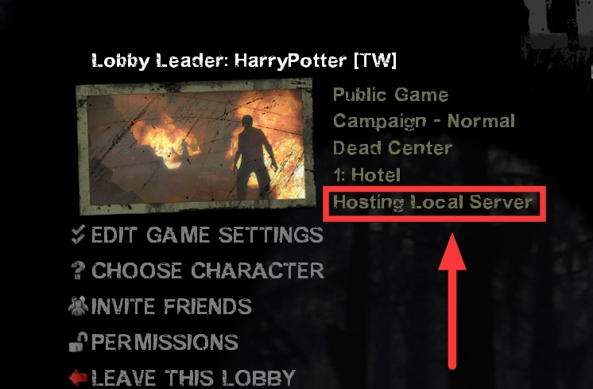
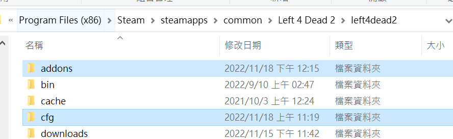
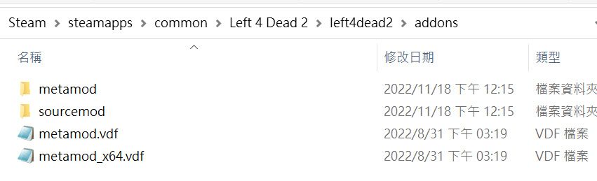
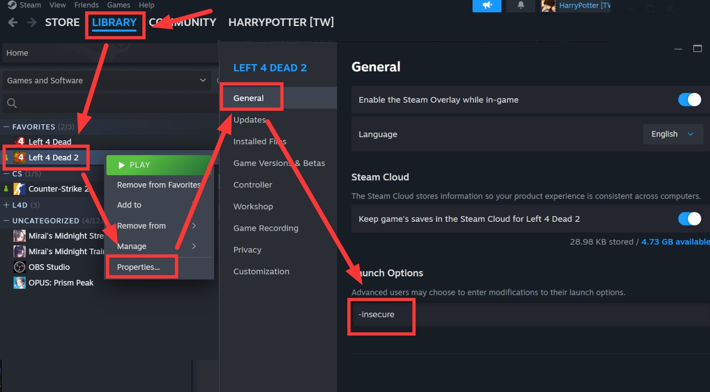
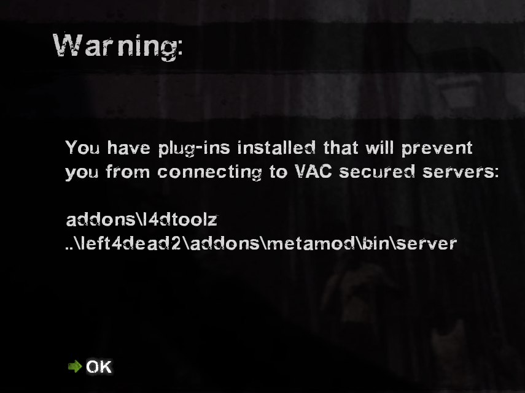
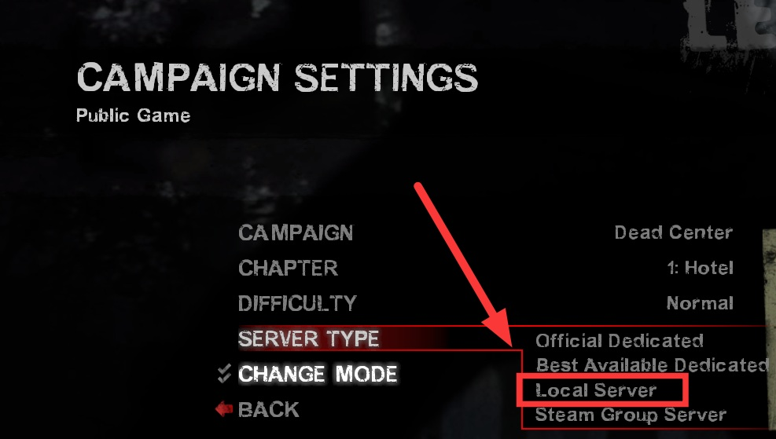
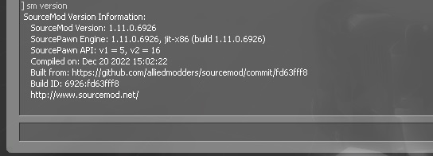

# Overview of Questions
> Updated 2025/8/25
- [Overview of Questions](#overview-of-questions)
  - [What is a Listen Server](#what-is-a-listen-server)
  - [What is the difference between a Listen Server and a Dedicated Server](#what-is-the-difference-between-a-listen-server-and-a-dedicated-server)
  - [How to determine if a server is Listen or Dedicated](#how-to-determine-if-a-server-is-listen-or-dedicated)
  - [How to install SourceMod on a Listen Server](#how-to-install-sourcemod-on-a-listen-server)
  - [How to run a Listen Server](#how-to-run-a-listen-server)
  - [How to check the version](#how-to-check-the-version)
  - [How can friends join my Listen Server](#how-can-friends-join-my-listen-server)
  - [How to become an administrator of the server](#how-to-become-an-administrator-of-the-server)
  - [How to compile source code](#how-to-compile-source-code)
  - [How to install plugins](#how-to-install-plugins)
  - [How to check if a plugin is working properly](#how-to-check-if-a-plugin-is-working-properly)
  - [How to remove plugins](#how-to-remove-plugins)
  - [How to update plugins](#how-to-update-plugins)
  - [How to manually manage plugins](#how-to-manually-manage-plugins)
  - [How to check cvar values](#how-to-check-cvar-values)
  - [How to modify cvars](#how-to-modify-cvars)
  - [How to use plugin commands](#how-to-use-plugin-commands)
  - [How to update a Listen Server](#how-to-update-a-listen-server)
  - [How to update SourceMod](#how-to-update-sourcemod)
  - [Others](#others)
> __Note__ This guide strictly applies to SourceMod and has no relation to AMX Mod X.
- - - -
## What is a Listen Server
* <details><summary>Explanation (Click to expand)</summary>

   * A Listen Server is also known as a local host, local server, or local lobby.
   * Host Server via "Create Lobby", starting a Single Player game, or using console commands to host a room are all considered Listen Servers.
   <br/>

   * The host who creates the lobby is the server itself.
      * As soon as the host leaves the game, the server will cease to exist, and all players will be kicked back to the lobby.
      * If the host uses too many mods or drastically modifies network parameters, it will affect the entire server.
      * In other words, server performance and stability depend on the host's local network and game setup.
</details>

- - - -
## What is the difference between a Listen Server and a Dedicated Server
- The full term for Dedicated Server is Dedicated Server.
- Any server launched via third-party software or tools is a Dedicated Server.
- A Listen Server requires no network configuration; you simply create a lobby and invite friends to play.
- A Dedicated Server requires basic network and IP knowledge. If your router and IP settings are not properly configured, no one will be able to join your server.

| Comparison | Listen Server | Dedicated Server |
| ------------- |:-----------------:|:-------------:|
| English Term | Listen Server | Dedicated Server |
| Stability | Average | Good |
| Smoothness | Average | Good |
| Plugin Support | Some plugins not supported | All plugins supported |
| Startup | Host starts game | Manual launch |
| Controls | Host's game console | Server console / backend |
| Shutdown | Auto-closes when host leaves | Manual shutdown |
| Restart | Host restarts game | Manual restart |
| Server Updates | Auto-updated with main game | Manual update |
| Executed cfg | cfg/listenserver.cfg | cfg/server.cfg |
| Network | No setup needed | Must configure public IP |
| Max Players | 8 players | Up to 32 players |
| Tickrate | 30 | Up to 100 |

- You can choose to install SourceMod on either a Dedicated Server or a Listen Server.
	- To install a Dedicated Server, check [this tutorial](/Tutorial_教學區/English/Server/Install_Dedicated_Server_Plugin/README.md).
	- A Dedicated Server is recommended because [SourceMod does not officially support Listen Servers](/Questions_問題區/English/Server/README.md#does-sourcemod-support-locallisten-servers), and all plugins support Dedicated Servers.
	- Most plugin authors will ignore issues reported on Listen Servers.
	- 🟥 Linux systems cannot install SourceMod on Listen Servers.

- - - -
## How to determine if a server is Listen or Dedicated
* <details><summary>Explanation (Click to expand)</summary>

   * After entering the game, open the developer console and type ```status```.
      * [How to open the developer console](/Tutorial_教學區/English/Game/README.md#how-to-enable-the-game-console)
      ```php
      ] status
      hostname: Resident Evil
      version : 2.2.2.5 8705 insecure  
      udp/ip  : 192.168.50.106:27015 [ public n/a ]
      os      : Windows Listen
      map     : c10m2_drainage at ( -11074, -9007, -529 )
      players : 1 humans, 0 bots (4 max) (not hibernating) (unreserved)
      ```
   * Look at the **os** line: **Listen** indicates a Listen Server, while **Dedicated** indicates a Dedicated Server.
</details>

- - - -
## How to install SourceMod on a Listen Server
* <details><summary>Installation Steps (Click to expand)</summary>

   1. Open [your main game root directory](/Tutorial_教學區/English/Game/README.md#how-to-open-the-main-game-directory-folder).

   2. Download the latest installation package from [SourceMod](https://www.sourcemod.net/downloads.php?branch=stable).
      - The Windows icon indicates the Windows OS version, and the Penguin icon indicates Linux OS. Select the Windows version to download.
      - A red icon indicates that the version does not support that OS platform yet.
      - [Do not download Dev builds](/Questions_問題區/English/Server/README.md#why-are-there-two-types-of-sourcemod-downloads).
      <br/>

   3. Download the latest installation package from [MetaMod](https://www.sourcemm.net/downloads.php?branch=stable).
      - Select the Windows version to download.
      - A red icon indicates that the version does not support that OS platform yet.
      <br/>
   
   4. Extract all files into the game root path. The folder structure should look as shown in the images (pay attention to the directory path).
      <br/>
      <br/>

   5. Go to [sourcemm.net vdf](https://www.sourcemm.net/vdf), select the corresponding game, click "Generate metamod.vdf", and download `metamod.vdf` into the `addons` folder to overwrite the existing file.
      <br/>
      <br/>
</details>

- - - -
## How to run a Listen Server
* <details><summary>Explanation (Click to expand)</summary>

   1. Enter `-insecure` in the game launch options as shown in the picture.
      <br/>

   2. Launch the game. Seeing a warning message is normal; click OK to proceed.
      <br/>

   3. Next steps:
      * Method 1: Single Player mode.
      * Method 2: Command host. Open the developer console and enter ```map xxxx```.
         * ```xxxx``` represents the map name.
         * [How to open the developer console](/Tutorial_教學區/English/Game/README.md#how-to-enable-the-game-console)
      * Method 3: Create Lobby => Select Server Type "Local Server" => Start Game.
      <br/>

   4. Check if SourceMod is working properly:
      * Press the `~` key to open the console and enter ```sm version```. If the output does not resemble the image below, previous steps were executed incorrectly; please double-check.
      <br/>
      
   > __Warning__
   > * To disable SourceMod and plugins, simply remove `-insecure` from the launch options.
   > * Adding `-insecure` to launch options will prevent you from joining VAC-secured servers.
</details>

- - - -
## How to check the version
* [See this guide](/Tutorial_教學區/English/Server/Install_Dedicated_Server_Plugin/README.md#how-to-check-versions)
* On a Listen Server, the server console corresponds to the host's in-game console.

- - - -
## How can friends join my Listen Server
* <details><summary>Explanation (Click to expand)</summary>

   1. Create a lobby.
   2. Invite friends.
   3. Start the game.
   4. Or host via single-player mode directly.
</details>

- - - -
## How to become an administrator of the server
* [See this guide](/Tutorial_教學區/English/Server/Install_Dedicated_Server_Plugin/README.md#how-to-become-a-server-admin)
	 
- - - -
## How to compile source code
* [See this guide](/Tutorial_教學區/English/Server/Install_Dedicated_Server_Plugin/README.md#how-to-compile-source-code)
 
- - - -
## How to install plugins
* [See this guide](/Tutorial_教學區/English/Server/Install_Dedicated_Server_Plugin/README.md#how-to-install-plugins)

- - - -
## How to check if a plugin is working properly
* [See this guide](/Tutorial_教學區/English/Server/Install_Dedicated_Server_Plugin/README.md#how-to-verify-plugins-are-working-properly)
* On a Listen Server, the server console corresponds to the host's in-game console.

- - - -
## How to remove plugins
* [See this guide](/Tutorial_教學區/English/Server/Install_Dedicated_Server_Plugin/README.md#how-to-remove-plugins)
* On a Listen Server, the server console corresponds to the host's in-game console.

- - - -
## How to update plugins
* [See this guide](/Tutorial_教學區/English/Server/Install_Dedicated_Server_Plugin/README.md#how-to-update-plugins)
* On a Listen Server, the server console corresponds to the host's in-game console.

- - - -
## How to manually manage plugins
* [See this guide](/Tutorial_教學區/English/Server/Install_Dedicated_Server_Plugin/README.md#how-to-manually-manage-plugins)
* On a Listen Server, the server console corresponds to the host's in-game console.

- - - -
## How to check cvar values
[See this guide](/Tutorial_教學區/English/Server/Install_Dedicated_Server_Plugin/README.md#how-to-check-convar-values)
* On a Listen Server, the server console corresponds to the host's in-game console.

- - - -
## How to modify cvars
* <details><summary>Cvars bundled with plugins</summary>

   * If a corresponding .cfg file is automatically generated:
      1. Open the corresponding .cfg file in `cfg/sourcemod/` -> modify cvars -> save.
      2. Change the map or restart the game.<br/>

   * If a corresponding .cfg file is NOT automatically generated:
      1. Write cvars into `cfg/listenserver.cfg` -> save.
         * Create `listenserver.cfg` if it doesn't exist.
      2. Change the map or restart the game.
   > __Note__ Some plugins automatically generate .cfg files, while others with custom cvars do not; it depends on the plugin author.
</details>

* <details><summary>Default official game cvars</summary>

   1. Write cvars into `cfg/listenserver.cfg` -> save.
      * Create `listenserver.cfg` if it doesn't exist.
   2. Change the map or restart the game.
   > __Note__ Some official cvars require `sm_cvar` to take effect, e.g., ```sm_cvar sb_stop 1```.
</details>

* <details><summary>Modifying cvars mid-game</summary>

  * Method 1: In-game admin types command and value in console, prefixed with ```sm_cvar```:
    ```php
    ] sm_cvar a4d_always_force_bosses 1
    ```
  * Method 2: In-game admin types command and value in chat box, prefixed with ```!cvar```:
    ```php
      Harry : !cvar a4d_always_force_bosses 1
    ```
   > __Warning__ Even if modified mid-game, cvars might revert upon loading the next map. Make proper use of .cfg files for persistent changes.
</details>

- - - -
## How to use plugin commands
[See this guide](/Tutorial_教學區/English/Server/Install_Dedicated_Server_Plugin/README.md#how-to-use-plugin-commands)
* On a Listen Server, the server console corresponds to the host's in-game console.

- - - -
## How to update a Listen Server
* [Simply just verify game files](/Tutorial_教學區/English/Game/README.md#verifying-integrity-of-game-files)

- - - -
## How to update SourceMod
* <details><summary>Explanation (Click to expand)</summary>

   1. Back up first:
         * All cfg files inside `cfg/sourcemod`
         * All source codes inside `sourcemod/scripting`
         * All files inside `sourcemod/data`
         * All files inside `sourcemod/configs`
   2. Delete the `addons` folder to start fresh.
      * Reinstall SourceMod and MetaMod.
   3. Reinstall all plugins.
      * Check online to see if any plugins have updates if necessary.
      * It is recommended to download and update to the latest versions of plugins.
      * It is recommended to keep source code files and compile them yourself.
</details> 

- - - -
## Others
* [Tutorial for installing other files](/Tutorial_教學區/English/Server/Install_Other_File/README.md)
* [Installing Dedicated Servers and Plugins](/Tutorial_教學區/English/Server/Install_Dedicated_Server_Plugin/README.md)
* [How to host an 8-player Campaign mode server](/Tutorial_教學區/English/Game/L4D2/8+_Survivors_In_Coop/README.md#navigation)